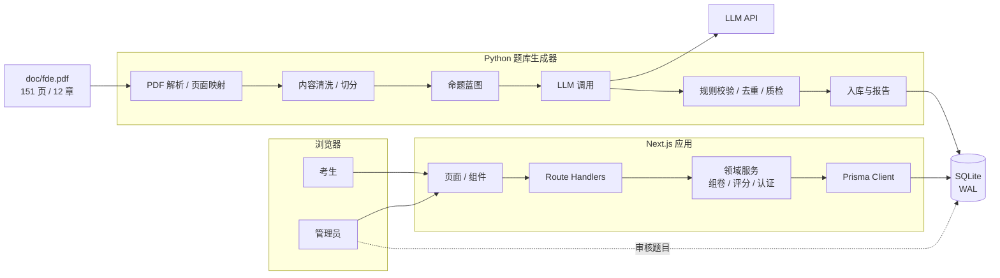
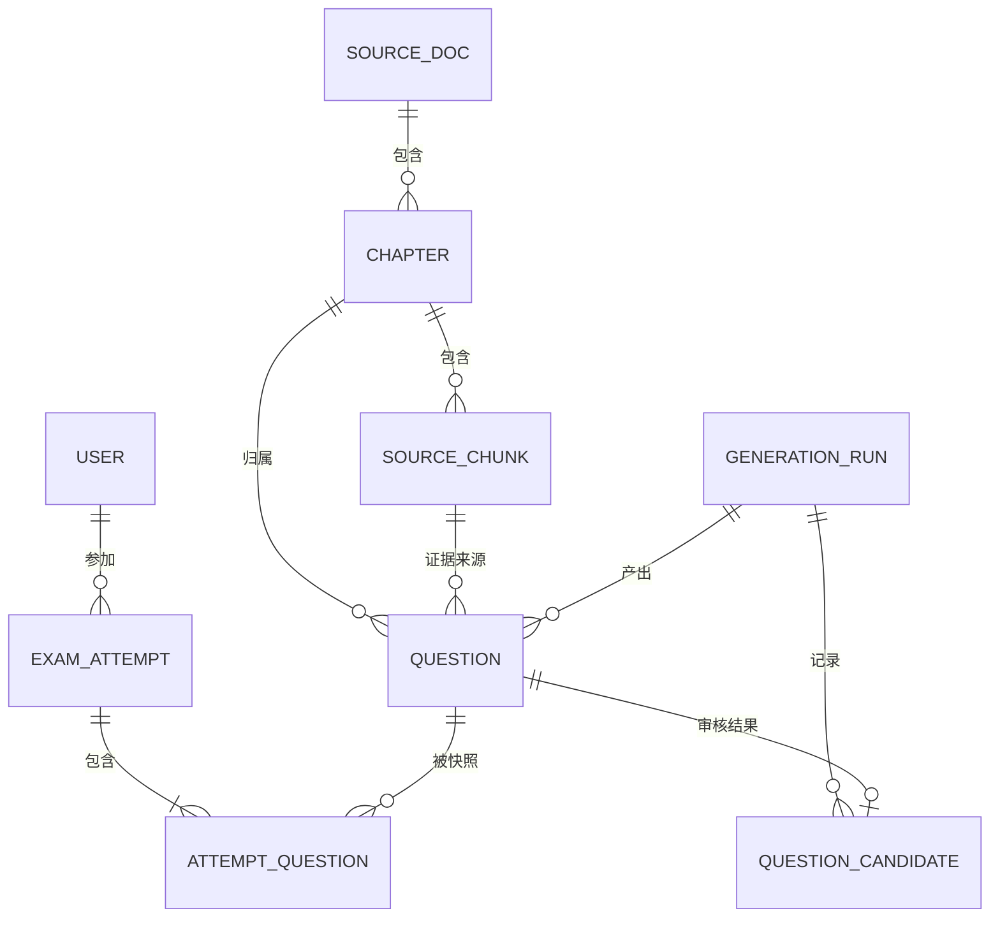
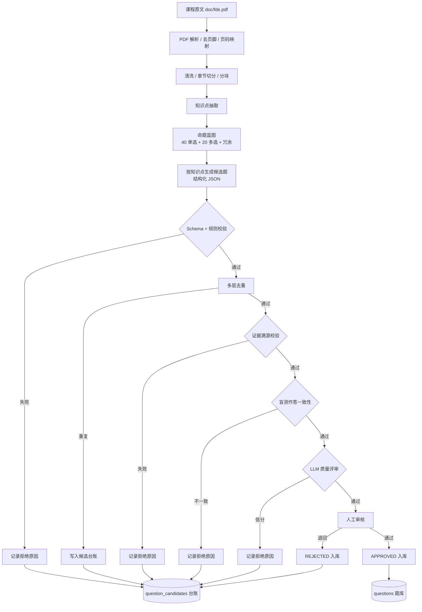
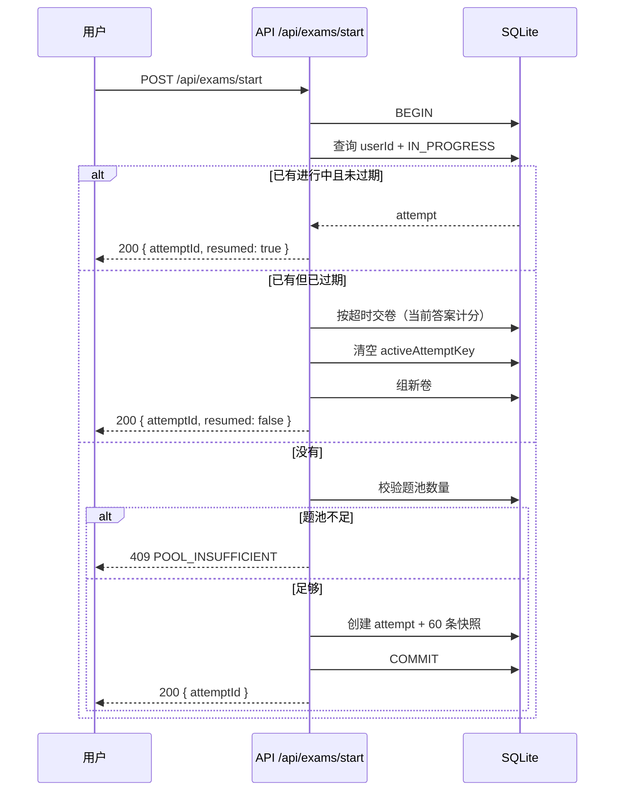
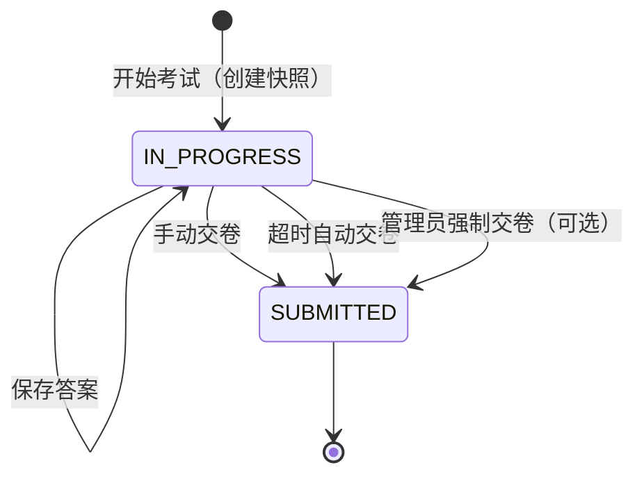
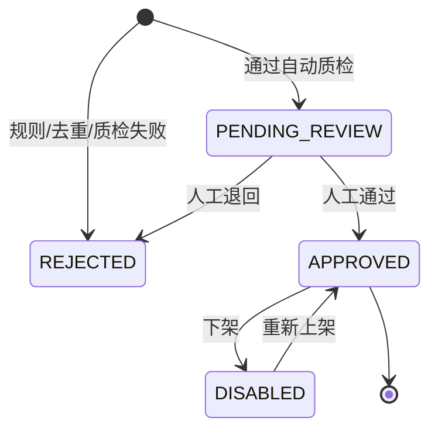

# FDE 答题系统方案设计

| 项目 | 内容 |
| --- | --- |
| 文档版本 | v1.3（已实现，出题规则优化） |
| 编写日期 | 2026-11-25 |
| 适用范围 | 基于已导出的腾讯云课程《course-4767-84816-84841》PDF 内容生成题库，并提供模拟考试、成绩与做题记录功能 |
| 原文资产 | `fde-exam/doc/fde.pdf`（151 页 / 12 章 / 31 张图，含文本层） |
| 技术栈 | Next.js + React + Prisma + SQLite；Python 题库生成脚本 |
| 文档位置 | `fde-exam/doc/答题系统方案设计.md` |

> **v1.1 变更**：原文输入由“在线页面 / Markdown”调整为已导出的 `doc/fde.pdf`（151 页 / 12 章 / 31 张图）；新增 PDF 解析、页码映射、`source_page` 证据校验、页面可回查的历史快照与对应测试项。
>
> **v1.2 实现状态**：已按本方案完成 `fde-exam/web`（Next.js + Prisma + SQLite）与 `fde-exam/generator`（PyMuPDF + LLM 生成 / 去重 / 质检）的可运行实现。启动方式、账号和命令见 `fde-exam/README.md`。当前 SQLite 中已导入 12 章、291 个原文分块；配置 `LLM_API_KEY` 或 OpenCode `OPENAI_API_KEY` 后可运行正式生成流程。
>
> **v1.3 出题规则优化**：根据 `doc/fde/模拟.md` 的 15 道样题，禁止“某小节属于哪一章/哪一页”类目录题，强制场景、决策、排查、流程、对比、口径、判断七类形态；新增 `style` 字段、风格配额、R17–R20 规则，并在 Prompt 中加入风格示例。当前示例库已生成并审核通过 **102 题**（76 单选 / 26 多选），目录题 0 道。

---

## 目录

- [1. 背景与目标](#1-背景与目标)
- [2. 需求拆解与关键决策](#2-需求拆解与关键决策)
- [3. 总体架构](#3-总体架构)
- [4. 课程内容准备](#4-课程内容准备)
- [5. 数据库设计](#5-数据库设计)
- [6. 题库生成方案（核心）](#6-题库生成方案核心)
- [7. 系统功能实现](#7-系统功能实现)
- [8. 安全与合规](#8-安全与合规)
- [9. 测试计划](#9-测试计划)
- [10. 里程碑与任务拆分](#10-里程碑与任务拆分)
- [11. 风险与对策](#11-风险与对策)
- [12. 待确认问题](#12-待确认问题)
- [附录 A：命题 Prompt 模板](#附录-a命题-prompt-模板)
- [附录 B：题目 JSON Schema 与校验规则](#附录-b题目-json-schema-与校验规则)
- [附录 C：去重核心伪代码](#附录-c去重核心伪代码)
- [附录 D：配置项清单](#附录-d配置项清单)

---

## 1. 背景与目标

### 1.1 背景

需要把腾讯云课程页面（<https://cloud.tencent.com/edu/learning/course-4767-84816-84841>）的内容转化为可练习的题库，并搭建一个轻量的在线答题系统。题库由 Python 脚本借助大模型批量生成，系统侧负责组卷、答题、评分和做题记录。

> 当前进展：课程原文已从登录态页面导出为 `fde-exam/doc/fde.pdf`，共 **151 页、12 章、31 张插图**，且带文本层，可直接用于解析和出题。生成器不再依赖在线抓取，而是以这份 PDF 为唯一事实来源。原课程页需腾讯云登录（未登录会跳转 `/login/verify`），因此 PDF 更新仍是人工/授权操作，不在代码中绕过登录或做反爬。

### 1.2 建设目标

1. **题库可用**：生成 60 道可组成满分 100 分试卷的题目，并保留冗余题池，支持每次随机组卷。
2. **题目可信**：每题可追溯到原文片段，答案可验证，尽量杜绝事实错误、歧义题和“背题感”题目。
3. **题目不重复**：从“生成前约束、生成中去重、入库强约束、运行后扫描”四个层面保证不重复。
4. **考试闭环**：注册/登录 → 开始或继续考试 → 答题自动保存 → 交卷评分 → 查看记录与逐题解析。
5. **单活跃试卷**：同一用户同一时间最多一份 `IN_PROGRESS` 试卷，刷新、关页、换设备后都能继续作答。
6. **可维护**：题库生成、审核、上下线有状态和审计信息；题目修改不影响历史试卷。

### 1.3 非目标（本期不做）

- 多租户、组织/班级管理。
- 付费、证书发放、排行榜。
- 高并发分布式部署（SQLite 单机足够）。
- 复杂防作弊（摄像头监考、切屏检测等）。
- 题目图片/公式渲染（如原文需要，后续再扩展富文本）。

---

## 2. 需求拆解与关键决策

### 2.1 分值推导

设单选题 `x` 道，多选题 `y` 道：

```text
x + y = 60
1.5x + 2y = 100
=> x = 40, y = 20
```

即：

| 题型 | 数量 | 单题分值 | 小计 |
| --- | ---: | ---: | ---: |
| 单选题 | 40 | 1.5 | 60 |
| 多选题 | 20 | 2 | 40 |
| **合计** | **60** | - | **100** |

及格线 70 分，即至少答对 47 道单选题（70.5 分），或等价组合。

### 2.2 关键设计决策

| 编号 | 决策点 | 结论 | 理由 |
| --- | --- | --- | --- |
| D1 | 题库规模 | **题池 ≥ 120 道已审核题**，每套随机抽 60 道 | 固定 60 道会导致所有人题目完全一样，也无法换卷；题池冗余同时是去重和质量筛选的缓冲 |
| D2 | 多选题计分 | 默认**全对得分，多选/少选/错选均 0 分** | 规则简单、可解释；如后续要部分分，可配置为“少选得一半、错选 0 分” |
| D3 | 组卷方式 | 按章节 + 难度分层随机，选项顺序也随机 | 保证覆盖面和每次试卷差异 |
| D4 | 考试时长 | 默认 90 分钟，可配置 | 60 题平均 1.5 分钟/题；超时自动交卷 |
| D5 | 单活跃试卷 | 数据库唯一约束 + 应用事务双重保证 | 防止并发点击“开始考试”生成两份 |
| D6 | 历史数据 | 组卷时**快照题干/选项/答案/解析** | 题库后续修改、下架不影响历史记录 |
| D7 | 答案下发 | 答题阶段接口**绝不返回答案和解析**，交卷后才返回 | 防止抓包看答案 |
| D8 | 题目状态 | 只有 `APPROVED` 题目可入卷 | 生成 ≠ 可用，必须有质量闸门 |
| D9 | 课程原文 | 以 `doc/fde.pdf` 为权威输入，解析后生成 Markdown + 页码结构 | PDF 已包含文本层；生成器不处理登录态与在线抓取 |
| D10 | 题目生成模型 | 任意 OpenAI 兼容接口（默认 DeepSeek/腾讯混元均可） | 便于替换供应商，Prompt 与解析不绑定厂商 |

> 若业务上确实要求“全站固定 60 题”，只需把 `EXAM_FIXED_PAPER=true`，组卷时按固定题库排序取全部 60 题；架构不变。

---

## 3. 总体架构

### 3.1 技术选型

| 层 | 选型 | 说明 |
| --- | --- | --- |
| Web 框架 | Next.js 16（App Router）+ React 19 + TypeScript | 服务端组件 + Route Handler，前后端一体 |
| ORM | Prisma 7 | Schema 即文档；迁移可追踪 |
| 数据库 | SQLite（WAL 模式） | 单机、零运维；开启 WAL 提升读写并发 |
| SQLite 驱动 | `@prisma/adapter-better-sqlite3` + `better-sqlite3` | Prisma 7 使用 driver adapter |
| 认证 | 自研轻量 JWT Cookie（`jose`）+ `bcryptjs` | 无需引入完整 Auth 框架；HttpOnly + SameSite |
| 参数校验 | `zod` | API 入参、表单、生成结果二次校验 |
| UI | Tailwind CSS 4（可选 shadcn/ui） | 轻量、易定制 |
| 图表（可选） | 无 / 轻量 SVG | 记录页只需要分数与正确率 |
| 生成器 | Python 3.12 + `uv` + `openai` SDK + `pydantic` + `typer` | 与现有仓库 Python 工具链一致 |
| 测试 | Vitest + Testing Library + Playwright + pytest | 单元、集成、E2E 全覆盖 |

### 3.2 逻辑架构



### 3.3 模块职责

| 模块 | 职责 |
| --- | --- |
| `auth` | 注册、登录、登出、会话解析、角色校验 |
| `exam` | 开始/恢复考试、组卷、答题保存、交卷、超时处理 |
| `grading` | 单选/多选判分、总分、及格判定 |
| `records` | 历史试卷列表、详情、逐题解析 |
| `questions` | 题库查询、状态管理、管理端审核 |
| `generator` | PDF 解析/页面映射 → 蓝图 → 题目 → 校验 → 去重 → 入库 → 报告 |
| `shared` | 类型、常量、错误码、时间处理 |

### 3.4 推荐目录结构

```text
fde-exam/
├── doc/
│   ├── 答题系统方案设计.md
│   └── fde.pdf                     # 课程原文（151 页 / 12 章，权威来源）
├── data/
│   └── source/
│       ├── fde.md                  # PDF 解析 + 清洗后的 Markdown
│       ├── fde.structure.json      # 章节树、页码范围、小节锚点
│       └── fde.meta.json           # 来源 URL、PDF 文件 hash、解析时间
├── web/                            # Next.js 应用
│   ├── prisma/
│   │   ├── schema.prisma
│   │   ├── migrations/
│   │   └── seed.ts                 # 管理员账号、可选演示数据
│   ├── src/
│   │   ├── app/
│   │   │   ├── (auth)/login/page.tsx
│   │   │   ├── (auth)/register/page.tsx
│   │   │   ├── (main)/page.tsx              # 首页：开始/继续考试
│   │   │   ├── (main)/exam/[attemptId]/page.tsx
│   │   │   ├── (main)/records/page.tsx
│   │   │   ├── (main)/records/[attemptId]/page.tsx
│   │   │   ├── (admin)/admin/questions/page.tsx
│   │   │   └── api/...
│   │   ├── components/
│   │   ├── lib/
│   │   │   ├── auth.ts
│   │   │   ├── db.ts
│   │   │   ├── exam-paper.ts
│   │   │   ├── grading.ts
│   │   │   └── validation.ts
│   │   └── generated/prisma/
│   ├── .env.example
│   └── package.json
├── generator/                      # Python 生成器
│   ├── pyproject.toml
│   ├── fde_exam_gen/
│   │   ├── cli.py
│   │   ├── config.py
│   │   ├── pdf_parser.py        # PyMuPDF：页/块/表格/图片 + 页码映射
│   │   ├── ingest.py            # 清洗、章节切分、生成 fde.md / structure.json
│   │   ├── blueprint.py
│   │   ├── prompts/
│   │   │   ├── generate.md
│   │   │   ├── blind_solve.md
│   │   │   └── judge.md
│   │   ├── llm.py
│   │   ├── generate.py
│   │   ├── validate.py
│   │   ├── dedupe.py
│   │   ├── quality.py
│   │   ├── repository.py
│   │   └── report.py
│   ├── tests/
│   └── reports/
├── scripts/
│   └── export_source.md            # PDF 更新、校验与重新解析说明
├── Makefile
└── README.md
```

### 3.5 部署形态

- 单机部署：Node 进程 + SQLite 文件（`web/prisma/dev.db`）。
- Python 生成器**离线运行**，与 Web 共用同一个 SQLite 文件。
- 生产建议：
  - SQLite 开启 `journal_mode=WAL`、`busy_timeout=5000`、`synchronous=NORMAL`。
  - 只运行一个 Next.js 实例（或写请求走单实例），避免多写者竞争。
  - 定时备份：`sqlite3 .backup` 或 Litestream。
- 生成期间 Web 可正常读；题目写入使用短事务，避免长时间锁库。

---

## 4. 课程内容准备

### 4.1 已获取的 PDF 资产

课程原文已导出为 `fde-exam/doc/fde.pdf`，这是题库生成的**唯一事实来源**。

| 属性 | 值 |
| --- | --- |
| 文件 | `fde-exam/doc/fde.pdf` |
| 页数 | 151 页 |
| 章节 | 12 章 |
| 插图 | 31 张（21 张位图 + 10 张 SVG/矢量图） |
| 文本层 | 有，可直接抽取文字 |
| 结构 | 第 1 页封面，第 2～3 页目录，第 4～151 页正文 |

各章起始页（PDF 绝对页码，已校验）：

| 章节 | 起始页 | 结束页 |
| --- | ---: | ---: |
| 01 概览与方法论 | 4 | 13 |
| 02 腾讯云AI重点产品介绍 | 14 | 27 |
| 03 人工智能工程 | 28 | 39 |
| 04 WorkBuddy 上手实操 | 40 | 48 |
| 05 管理端：企业后台与 WMA 配置实战 | 49 | 65 |
| 06 进场：挖真需求、破一线抵触 | 66 | 81 |
| 07 交付：做成、且验得动 | 82 | 96 |
| 08 沉淀：把经验变成组织资产 | 97 | 110 |
| 09 综合实战：12 周 FDE 养成计划 | 111 | 123 |
| 10 安全治理与护栏 | 124 | 136 |
| 11 案例实战：企业 CFO 财务结算审核 | 137 | 143 |
| 12 关键问题 FAQ | 144 | 151 |

> 合规提示：PDF 仅用于内部学习与出题，不对外分发；生成题目应做改写，避免大段复制原文。

### 4.2 PDF 解析与页面映射

生成器第一步不是直接调用 LLM，而是把 PDF 转成“**可追溯的结构化文本**”：

```text
doc/fde.pdf
  → PyMuPDF 逐页解析
  → 去页眉页脚 / 合并断行 / 识别标题 / 还原表格
  → data/source/fde.md（供 LLM 阅读）
  → data/source/fde.structure.json（章节、页码、锚点）
  → 分块入库（source_chunks，含 pageStart/pageEnd）
```

解析要点：

1. **文本抽取**
   - 使用 `PyMuPDF` 的 `page.get_text("dict")`，按 `block → line → span` 取文本；
   - 按 `(y, x)` 排序，避免双栏/表格导致阅读顺序错乱；
   - 合并段落内的换行，去掉行尾连字符（英文）和多余空格；
   - 统一全半角、引号、破折号，去掉连续空行。
2. **忽略非正文页**
   - 第 1 页封面、第 2～3 页目录不进入出题语料；
   - 目录只用于校验“12 章标题/小节标题”是否完整。
3. **去页脚/页眉**
   - 本次导出的 PDF 页脚格式为 `FDE Course Notes | 4 / 151`，用正则统一剔除：
     ```text
     ^FDE Course Notes\s*\|\s*\d+\s*/\s*\d+$
     ```
   - 如后续 PDF 版式变化，把重复出现的页眉/页脚文本加入 `ignore_patterns`，不要进入 chunk。
4. **标题识别**
   - 章标题：`^\d{2}\s+`（如 `01 概览与方法论`）；
   - 小节标题：`^\d+\.\d+\s+`（如 `1.1 FDE 的本质定义`）；
   - 结合字号/加粗特征做二次确认，避免把正文中的编号误判为标题。
5. **表格还原**
   - 优先用 `page.find_tables()`；复杂表格用 `pdfplumber` 兜底；
   - 输出时保留表头，并把每一行转成“行级事实”，例如：
     `产品 | 核心用户 | 交付形态 | 上线周期`
   - 单元格合并/列错位无法可靠还原时标记 `table_confidence=low`，该表不直接出题，或仅作为背景材料。
6. **图片处理**
   - 用 `page.get_images(full=True)` 导出位图，记录 `pageNo / xref / caption`；
   - SVG/矢量图在 PDF 中通常已转为矢量路径，无法直接导出原图，但页面截图可保留；
   - 图片本身不作为唯一答案依据；只有正文/图注能说明清楚时，才允许出“与图相关”的题；
   - 需要读图才能回答的内容标记 `skip`，或后续接入视觉模型单独处理。

解析输出 `fde.structure.json` 示例：

```json
{
  "source": {
    "file": "doc/fde.pdf",
    "pages": 151,
    "sha256": "…",
    "parsedAt": "2026-11-25T20:35:00+08:00"
  },
  "chapters": [
    {
      "orderNo": 1,
      "title": "01 概览与方法论",
      "pageStart": 4,
      "pageEnd": 13,
      "sections": [
        { "title": "1.1 FDE 的本质定义", "pageStart": 4, "anchor": "sec-1-1" },
        { "title": "1.2 真假 FDE 的试金石", "pageStart": 6, "anchor": "sec-1-2" }
      ]
    }
  ]
}
```

### 4.3 章节结构与知识点

1. **12 章固定**
   - 章节顺序、标题、页码范围来自 `fde.structure.json`；
   - 组卷时每章至少 1 题，权重建议按“小节数量”归一化，避免页数多的章过度占题。
2. **小节对齐**
   - 以 `1.1 / 1.2 / …` 标题为知识点归属；
   - 若某小节跨页，记录 `pageStart/pageEnd`，chunk 继承该范围。
3. **知识点抽取**
   - 规则候选：小节标题、列表项、表格行、加粗术语；
   - LLM 合并同义项、命名、给出重要度（1～5）；
   - 产物 `knowledge_points.json`，每条包含 `name / importance / chunkIds / pageStart / pageEnd`。
4. **页码回填**
   - 每个 chunk 记录 `pageStart/pageEnd`；
   - 每道题必须能从 `sourceChunkId` 追溯到页码，用于审核与解析展示。

### 4.4 清洗、切分与不可出题内容

1. **清洗**：去封面、目录、页脚、重复页眉、广告、版权声明；统一全半角；合并断行。
2. **内容分块（chunk）**：
   - 目标 300～800 中文字符，按段落边界切，相邻块保留约 10% 重叠；
   - 每块记录 `chapterId`、`orderNo`、`content`、`contentHash`、`tokenCount`、`pageStart`、`pageEnd`；
   - 表格单独成块，表头带入每一行。
3. **不可出题内容**：
   - 封面、目录、页脚、页码、纯过渡句、致谢、广告、无信息量口号；
   - 依赖图片才能回答、且图注不足的内容；
   - 表格还原置信度低的内容；
   - 同一事实已在“本节目标/本章小结”重复出现时，优先从正文出题，避免重复。
4. **图片引用**：题目解析里可显示“第 X 页 · 图 Y”，但不把图片作为唯一答案来源。

### 4.5 内容版本管理

- `SourceDoc.fileHash` 记录 PDF 文件字节 hash；`SourceDoc.contentHash` 记录解析后全文 hash。
- PDF 更新时：
  1. 重新解析，生成新的 `fde.md` / `fde.structure.json`；
  2. 对比章节与页码，只对受影响章节增量生成；
  3. 旧题保留但可批量 `DISABLED`，历史试卷不受影响（已快照）；
  4. 在 `GenerationRun` 记录 `sourceHash + parserVersion + promptVersion + model + seed`，保证可追溯、可复现。
- 如果课程方更新了原文，不要直接覆盖旧 PDF；保留 `fde-YYYYMMDD.pdf` 版本并从新文件重新生成。

---

## 5. 数据库设计

### 5.1 ER 关系



### 5.2 Prisma Schema（草案）

> 说明：SQLite 对 `Json` 类型支持有限，统一用 `String` 存 JSON 文本，应用层用 `JSON.parse/stringify`；金额/分数用 `Float`。

```prisma
generator client {
  provider = "prisma-client"
  output   = "../src/generated/prisma"
}

datasource db {
  provider = "sqlite"
  // Prisma 7：连接串不再写在 schema 中，统一放到 prisma.config.ts
}

// ---------- 用户 ----------
model User {
  id           String   @id @default(cuid())
  username     String   @unique
  passwordHash String
  nickname     String?
  role         String   @default("USER") // USER | ADMIN
  status       String   @default("ACTIVE") // ACTIVE | DISABLED
  createdAt    DateTime @default(now())
  updatedAt    DateTime @updatedAt

  attempts ExamAttempt[]

  @@map("users")
}

// ---------- 原文 ----------
model SourceDoc {
  id          String   @id @default(cuid())
  title       String
  url         String?
  format      String   @default("PDF") // PDF | MARKDOWN
  filePath    String?
  fileHash    String? // PDF 文件 SHA-256
  pageCount   Int      @default(0)
  contentHash String   @unique // 解析后全文 hash
  wordCount   Int      @default(0)
  createdAt   DateTime @default(now())

  chapters Chapter[]

  @@map("source_docs")
}

model Chapter {
  id        String @id @default(cuid())
  docId     String
  title     String
  orderNo   Int
  weight    Float  @default(1) // 组卷权重
  pageStart Int?
  pageEnd   Int?
  anchor    String?

  doc       SourceDoc     @relation(fields: [docId], references: [id], onDelete: Cascade)
  chunks    SourceChunk[]
  questions Question[]

  @@unique([docId, orderNo])
  @@index([pageStart])
  @@map("chapters")
}

model SourceChunk {
  id          String @id @default(cuid())
  chapterId   String
  orderNo     Int
  content     String
  contentHash String
  tokenCount  Int    @default(0)
  pageStart   Int?
  pageEnd     Int?
  sectionRef  String? // 如 1.1
  tableConfidence String? // HIGH | LOW，仅表格块

  chapter   Chapter    @relation(fields: [chapterId], references: [id], onDelete: Cascade)
  questions Question[]

  @@unique([chapterId, orderNo])
  @@index([contentHash])
  @@index([pageStart])
  @@map("source_chunks")
}

// ---------- 题目 ----------
model Question {
  id       String @id @default(cuid())
  type     String // SINGLE | MULTIPLE
  style    String? // SCENARIO | TROUBLESHOOTING | COMPARISON | PROCESS | CALCULATION | JUDGMENT
  stem     String
  optionsJson String // [{"key":"A","content":"..."}]
  answerJson  String // ["B"] | ["A","C"]
  explanation String
  difficulty  String @default("MEDIUM") // EASY | MEDIUM | HARD

  chapterId      String?
  knowledgePoint String?
  sourceChunkId  String?
  evidenceQuote  String? // 原文证据片段
  sourceRef      String? // 章节/小节引用，如 1.1
  sourcePage     Int? // 证据所在 PDF 页码
  sourcePageEnd  Int?

  contentHash String  @unique // 精确去重：题干+选项+答案
  claim       String? // 本题考查的唯一事实（用于生成时禁止重复）
  claimHash   String? // 事实级去重
  simhash     String? // 近似去重：64bit hex
  embeddingJson String? // 语义去重向量
  dedupeMetaJson String? // 与最近题的相似度明细

  status       String  @default("PENDING_REVIEW") // PENDING_REVIEW | APPROVED | REJECTED | DISABLED
  rejectReason String?
  qualityScore Float?
  qualityDetailJson String?
  generationRunId String?
  promptVersion   String?
  version         Int     @default(1)

  reviewedBy String?
  reviewedAt DateTime?
  reviewNote String?

  createdAt DateTime @default(now())
  updatedAt DateTime @updatedAt

  chapter       Chapter?      @relation(fields: [chapterId], references: [id], onDelete: SetNull)
  sourceChunk   SourceChunk?  @relation(fields: [sourceChunkId], references: [id], onDelete: SetNull)
  generationRun GenerationRun? @relation(fields: [generationRunId], references: [id], onDelete: SetNull)
  attemptItems  AttemptQuestion[]

  @@index([status, type])
  @@index([chapterId, type])
  @@index([claimHash])
  @@index([simhash])
  @@index([sourcePage])
  @@index([generationRunId])
  @@map("questions")
}

// ---------- 生成运行与去重台账 ----------
model GenerationRun {
  id            String   @id @default(cuid())
  sourceHash    String
  model         String
  promptVersion String
  seed          Int?
  targetCount   Int
  generatedCount Int     @default(0)
  acceptedCount  Int     @default(0)
  rejectedCount  Int     @default(0)
  status        String   @default("RUNNING") // RUNNING | SUCCESS | FAILED | PARTIAL
  errorMessage  String?
  costUsd       Float?
  startedAt     DateTime @default(now())
  finishedAt    DateTime?

  questions  Question[]
  candidates QuestionCandidate[]

  @@index([status, startedAt])
  @@map("generation_runs")
}

/// 所有生成候选（含被拒绝的）都写台账，避免重复生成“已经被否掉的题”
model QuestionCandidate {
  id          String  @id @default(cuid())
  runId       String?
  type        String
  contentHash String  @unique
  claimHash   String?
  simhash     String?
  embeddingJson String?
  status      String // ACCEPTED | DUP_EXACT | DUP_NEAR | RULE_REJECTED | QUALITY_REJECTED | REVIEW_REJECTED
  rejectReason String?
  questionId  String? @unique
  createdAt   DateTime @default(now())

  run GenerationRun? @relation(fields: [runId], references: [id], onDelete: SetNull)

  @@index([status, createdAt])
  @@index([claimHash])
  @@index([simhash])
  @@map("question_candidates")
}

// ---------- 考试 ----------
model ExamAttempt {
  id       String @id @default(cuid())
  userId   String
  status   String @default("IN_PROGRESS") // IN_PROGRESS | SUBMITTED
  submitType String? // MANUAL | TIMEOUT | FORCED

  /// 进行中时 = userId，交卷/超时后置 NULL。
  /// SQLite 唯一索引允许多个 NULL，天然保证“一人最多一份进行中试卷”。
  activeAttemptKey String? @unique

  paperSeed String
  questionCount Int    @default(60)
  singleCount   Int    @default(40)
  multipleCount Int    @default(20)
  totalScore    Float  @default(100)

  startedAt   DateTime  @default(now())
  expiresAt   DateTime?
  submittedAt DateTime?
  durationSeconds Int?

  score       Float?
  passed      Boolean?
  correctCount Int?
  createdAt   DateTime @default(now())
  updatedAt   DateTime @updatedAt

  user  User             @relation(fields: [userId], references: [id], onDelete: Cascade)
  items AttemptQuestion[]

  @@index([userId, createdAt])
  @@index([userId, status])
  @@map("exam_attempts")
}

model AttemptQuestion {
  id         String @id @default(cuid())
  attemptId  String
  questionId String? // 题库被删也不影响历史
  orderNo    Int

  // 组卷快照：保证历史可复盘、题库改动不影响旧卷
  type        String
  stem        String
  optionsJson String // 已随机排序后的展示选项
  answerJson  String // 服务端保存的标准答案
  explanation String?
  chapterTitle String?
  knowledgePoint String?
  evidenceQuote  String?
  sourcePage     Int?

  userAnswerJson String? // ["A"] / ["A","C"] / null
  isCorrect      Boolean?
  score          Float   @default(0)
  maxScore       Float
  answeredAt     DateTime?

  attempt  ExamAttempt @relation(fields: [attemptId], references: [id], onDelete: Cascade)
  question Question?   @relation(fields: [questionId], references: [id], onDelete: SetNull)

  @@unique([attemptId, orderNo])
  @@index([questionId])
  @@map("attempt_questions")
}
```

### 5.2.1 Prisma 7 连接配置

Prisma 7 起，`datasource` 不再接受 `url`，连接串统一在 `prisma.config.ts` 配置；运行时通过 driver adapter 连接 SQLite。

```ts
// prisma.config.ts
import "dotenv/config";
import { defineConfig, env } from "prisma/config";

export default defineConfig({
  schema: "prisma/schema.prisma",
  migrations: { path: "prisma/migrations" },
  datasource: { url: env("DATABASE_URL") },
});
```

```ts
// src/lib/db.ts
import { PrismaBetterSqlite3 } from "@prisma/adapter-better-sqlite3";
import { PrismaClient } from "@/generated/prisma/client";

const adapter = new PrismaBetterSqlite3({
  url: process.env.DATABASE_URL ?? "file:./prisma/dev.db",
});

const globalForPrisma = globalThis as unknown as { prisma?: PrismaClient };

export const prisma = globalForPrisma.prisma ?? new PrismaClient({ adapter });

if (process.env.NODE_ENV !== "production") globalForPrisma.prisma = prisma;
```

依赖：`@prisma/client`、`@prisma/adapter-better-sqlite3`、`better-sqlite3`。开发环境用 `globalThis` 缓存实例，避免 Next.js 热更新反复创建连接。

### 5.3 关键约束说明

| 约束 | 作用 |
| --- | --- |
| `Question.contentHash @unique` | 精确重复的最后一道防线，并发插入也只成功一条 |
| `QuestionCandidate.contentHash @unique` | 被拒题也留痕，重跑不会再次生成同一道题 |
| `ExamAttempt.activeAttemptKey @unique` | 同一用户最多一份进行中试卷；并发“开始考试”只有一个成功 |
| `AttemptQuestion @@unique([attemptId, orderNo])` | 防止同一套卷题号重复 |
| `AttemptQuestion` 快照字段 | 历史记录不依赖题库当前状态 |
| `Question.status` | 只有 `APPROVED` 参与组卷 |
| `Question.sourcePage` / `SourceChunk.pageStart` | 题目与原文 PDF 页码可追溯，解析和审核都能回到原页 |
| `SourceDoc.fileHash` | 锁定 PDF 版本；文件变化时触发重新解析而不是静默沿用旧题 |
| `PRAGMA journal_mode=WAL` | 读写并发，答题写入不阻塞列表查询 |
| `PRAGMA busy_timeout=5000` | 生成器与 Web 偶发写冲突时自动重试等待 |

`activeAttemptKey` 的写法：

```ts
// 开始考试
await tx.examAttempt.create({
  data: { userId, status: "IN_PROGRESS", activeAttemptKey: userId, ... }
});

// 交卷
await tx.examAttempt.update({
  where: { id: attemptId },
  data: { status: "SUBMITTED", activeAttemptKey: null, submittedAt: new Date(), ... }
});
```

### 5.4 Prisma 与 Python 的协作方式

- **Prisma 是 Schema 的唯一事实来源**，通过 `prisma migrate dev` 生成 SQLite 表。
- Python 生成器使用标准库 `sqlite3`（或 SQLAlchemy Core）直连同一个文件，原因：
  - Python 只做批量写入和查询，不需要 ORM 的复杂关系能力；
  - 避免维护两套 ORM 模型导致漂移。
- 生成器启动时执行 **Schema 自检**：读取 `PRAGMA table_info(...)`，校验关键表和字段存在，版本不符直接失败并提示先执行迁移。
- 写入统一走 `repository.py`，所有 SQL 参数化，事务使用 `BEGIN IMMEDIATE`（写锁提前获取），并设置：
  ```sql
  PRAGMA journal_mode = WAL;
  PRAGMA busy_timeout = 5000;
  PRAGMA foreign_keys = ON;
  ```
- 字段命名：Prisma 的 `camelCase` 字段直接映射为 SQLite 列名（不逐列 `@map`），Python 侧保持一致。

### 5.5 数据字典（摘要）

| 表 | 用途 | 关键字段 |
| --- | --- | --- |
| `users` | 账号 | `username`、`passwordHash`、`role`、`status` |
| `source_docs` | 原文版本 | `filePath`、`fileHash`、`contentHash`、`pageCount` |
| `chapters` | 章节与组卷权重 | `orderNo`、`weight`、`pageStart`、`pageEnd` |
| `source_chunks` | 原文分块 | `content`、`contentHash`、`pageStart`、`pageEnd`、`sectionRef` |
| `questions` | 题库 | `type`、`style`、`contentHash`、`claim`、`claimHash`、`simhash`、`sourcePage`、`status` |
| `generation_runs` | 每次生成任务 | `model`、`promptVersion`、计数 |
| `question_candidates` | 去重台账（含拒绝） | `contentHash`、`status`、`rejectReason` |
| `exam_attempts` | 试卷实例 | `activeAttemptKey`、`score`、`passed` |
| `attempt_questions` | 试卷题目快照与作答 | `userAnswerJson`、`isCorrect`、`score`、`sourcePage` |

---

## 6. 题库生成方案（核心）

### 6.1 生成流水线



流水线采用“**宽进严出**”：先生成约 120～150 道候选，经过校验、去重、质检、人工审核后保留至少 80 道，确保能稳定组出 60 题/卷且有余量换卷。

### 6.2 命题蓝图与配额

#### 6.2.1 题量计算

| 项目 | 数量 | 说明 |
| --- | ---: | --- |
| 每卷单选题 | 40 | 1.5 分/题 |
| 每卷多选题 | 20 | 2 分/题 |
| 目标题池（审核通过） | ≥ 120 | 至少支持 2 套不重复试卷 |
| 建议候选生成量 | 150～180 | 预计 30%～40% 被去重/质检淘汰 |
| 每知识点题量 | 1～3 | 防止同一知识点反复出题 |

如果课程章节较少，题池可降到 90～100；系统在组卷时会检查可用题量，不足则返回明确错误而不是生成残缺试卷。

#### 6.2.2 章节与难度分配

- **章节配额**：12 章按 `chapter.weight` 用“最大余数法”分配 60 题，保证每章至少 1 题。权重建议按小节数量（而非页数）归一化，避免第 5、11 章等长章节占用过多题量。
- **题型拆分**：每章配额按 2:1 拆成单选/多选（四舍五入后全局校正到 40/20）。
- **难度分布**：建议 EASY 50%、MEDIUM 40%、HARD 10%（60 题约 30/24/6）。
- **页码覆盖**：同一章内尽量覆盖不同小节和不同页码区间，避免所有题都来自章首“本节目标”。
- **风格配额**：单选按 `SCENARIO → TROUBLESHOOTING → COMPARISON → PROCESS → CALCULATION → JUDGMENT` 轮转，多选以 `JUDGMENT` 为主，穿插 `COMPARISON / PROCESS`；目录题占比必须为 0。
- **认知层次**（可选）：记忆 40%、理解 40%、应用 20%，在 Prompt 中标注，避免全是名词解释。
- **答案分布**：单选题正确项 A/B/C/D 各占 15%～35%，生成后做批次平衡。

蓝图产物示例：

```json
{
  "exam": { "single": 40, "multiple": 20, "totalScore": 100, "passScore": 70 },
  "chapters": [
    {
      "title": "01 概览与方法论",
      "pageStart": 4,
      "pageEnd": 13,
      "quota": 6,
      "single": 4,
      "multiple": 2,
      "knowledgePoints": [
        { "name": "Echo 的职责", "quota": 2, "chunkIds": ["c1", "c2"], "pageStart": 4 },
        { "name": "Delta 的职责", "quota": 2, "chunkIds": ["c2", "c3"], "pageStart": 5 }
      ]
    }
  ]
}
```

### 6.3 生成单元与 Prompt 策略

**生成单元 = 一个知识点 + 1～3 个原文块**，每次只让模型出 1～3 道题。原因：

- 一次生成太多题，模型容易重复、编造、质量下降；
- 小批次便于失败重试和精确定位；
- 便于把“已考过的事实”放进上下文，主动避免重复。

Prompt 设计要点：

1. **角色**：课程命题专家，不是通用百科。
2. **唯一事实来源**：只允许使用给定原文；原文没写的不能考。
3. **一题一事实**：要求模型输出 `claim`（本题考查的唯一断言），用于事实级去重。
4. **题型约束**：单选 4 选 1；多选 4 选 2～3（可配置 4～6 选 2～4）。
5. **干扰项约束**：同类别、同粒度、长度相近；每个干扰项对应一种常见误解；禁止“以上都对/都不对”。
6. **证据引用**：必须给出原文连续片段 `evidence_quote` 和所在 PDF 页码 `source_page`，用于程序校验与审核定位。
7. **输出格式**：严格 JSON，字段固定；不使用 Markdown 代码块。
8. **禁止目录题**：不得出现“某小节属于哪一章/哪一页”“以下哪一项是第 X 章的小节”“课程目录”等问法；题干和选项都不能只是章节/小节标题。
9. **场景化题干**：必须从客户场景与选型、方案决策、故障排查、流程/阶段、成本/积分口径、方案对比、常见误区辨析切入，不能只问“X 是什么”。
10. **风格字段**：每题输出 `style`，取值 `SCENARIO / TROUBLESHOOTING / COMPARISON / PROCESS / CALCULATION / JUDGMENT`。
11. **解析要求**：逐项说明正确项为什么对，至少指出两个干扰项错在哪里。
12. **多样性**：同一知识点不要反复出同一种问法；优先考“怎么判断、怎么选、先做什么、为什么错”。
13. **禁止项**：不考页码/版本号本身；不考日期/数字除非原文明确；不考有争议的观点；不考需要图片才能回答的内容。

温度建议：单选 `0.3～0.5`，多选 `0.4～0.6`；同一知识点多次重试时提高多样性，但事实约束不变。

完整模板见 [附录 A](#附录-a命题-prompt-模板)。

#### 6.3.1 题目示例与反例

> 以下示例说明“场景化”选题方式：具体事实以课程原文为准，`evidence_quote` 需替换为原文逐字片段。

**合格示例（SCENARIO 单选）**

```json
{
  "type": "SINGLE",
  "style": "SCENARIO",
  "stem": "某客户 IT 团队希望从零构建一个与内部 ERP/CRM 深度集成、可长期迭代的定制化 AI 应用。应优先推荐哪款产品？",
  "options": [
    { "key": "A", "content": "WorkBuddy（办公助理）" },
    { "key": "B", "content": "CodeBuddy（编程助手）" },
    { "key": "C", "content": "ADP（智能体开发平台）" },
    { "key": "D", "content": "Miora（创意工作室）" }
  ],
  "answer": ["C"],
  "explanation": "客户要的是可长期迭代、与 ERP/CRM 深度集成的企业自有 AI 应用，符合 ADP 的定制化开发定位；WorkBuddy 偏办公助理，CodeBuddy 偏研发提效，Miora 偏创意物料。",
  "evidence_quote": "ADP：为有定制化 AI 应用需求的企业提供开发与运行环境",
  "source_page": 19,
  "claim": "需要与 ERP/CRM 深度集成并长期迭代时优先选择 ADP",
  "knowledge_point": "WorkBuddy / CodeBuddy / ADP / Miora 选型",
  "difficulty": "MEDIUM"
}
```

**合格示例（TROUBLESHOOTING 单选）**

```json
{
  "type": "SINGLE",
  "style": "TROUBLESHOOTING",
  "stem": "客户现场的 MCP Server 一直连不上（客户端显示红色状态）。按正确的排查思路，应该怎么查？",
  "options": [
    { "key": "A", "content": "按从外到内排查：先查网络出口，再查配置层级，最后查凭据与权限" },
    { "key": "B", "content": "第一步就重写整个 MCP 配置文件，反复换地址直到连上" },
    { "key": "C", "content": "红色状态大多是第三方服务不稳定，优先换一个同类 MCP Server" },
    { "key": "D", "content": "红色状态基本都是凭据失效，直接重新生成 Token 即可" }
  ],
  "answer": ["A"],
  "explanation": "正确做法是从外到内逐层排除：网络出口、配置层级、凭据与权限。B 跳过定位直接重写配置，C 把问题推给第三方，D 未验证就认定凭据失效，都会掩盖真实原因。",
  "evidence_quote": "MCP 连不上时按网络、配置层级、凭据与权限的顺序排查",
  "source_page": 37,
  "claim": "MCP 连接失败应按网络出口、配置层级、凭据权限从外到内排查",
  "knowledge_point": "MCP 连接排查",
  "difficulty": "MEDIUM"
}
```

**合格示例（COMPARISON 多选）**

```json
{
  "type": "MULTIPLE",
  "style": "COMPARISON",
  "stem": "一个能交付的 Harness（包裹在模型外围的工程框架）需要补齐「五件套」。下列属于五件套的有？",
  "options": [
    { "key": "A", "content": "工具接入——让模型能调用外部 API/数据库/搜索" },
    { "key": "B", "content": "输入输出契约——定义输入 Schema 和输出 Schema 的校验" },
    { "key": "C", "content": "模型微调——用客户数据持续训练专属模型" },
    { "key": "D", "content": "护栏门禁——输入侧过滤敏感请求，输出侧检查合规性" }
  ],
  "answer": ["A", "B", "D"],
  "explanation": "Harness 五件套包括工具接入、输入输出契约、错误处理、护栏门禁和可观测；模型微调不属于五件套，是另一条能力路径。",
  "evidence_quote": "Harness 需要工具接入、输入输出契约、错误处理、护栏门禁与可观测五件套",
  "source_page": 31,
  "claim": "Harness 五件套不包含模型微调",
  "knowledge_point": "Harness 构建",
  "difficulty": "MEDIUM"
}
```

**反例及命中规则**

| 反例 | 问题 | 命中规则 |
| --- | --- | --- |
| “以下哪一项属于第 3 章的小节？” | 目录题，不考理解 | R17 |
| “以下哪些小节属于第 5 章？” | 目录题，选项是标题 | R17 |
| “某小节位于第几页？” | 页码题 | R17 |
| 选项含“以上都对” | 送分、可排除 | R06 |
| 单选题答案有 2 个 | 答案不唯一 | R01 |
| 题干直接出现答案词 | 泄题 | R07 |
| 选项长度差异悬殊（1 字 vs 30 字） | 暗示答案 | R08 |
| 证据片段不在原文 | 可能编造 | R11 / G2 |
| 无场景的“X 是什么” | 纯定义题 | R18 |
| 同一知识点第 4 道“定义题” | 过度集中、重复 | 配额 + Claim 去重 |
| 换说法再问同一事实 | 语义重复 | Claim / Embedding 去重 |

### 6.4 结构化输出与程序校验

模型输出先经过 **Pydantic 模型** 校验，再进规则引擎。任何一步失败都记录 `rejectReason`，不进入题库。

```python
class Option(BaseModel):
    key: Literal["A", "B", "C", "D", "E", "F"]
    content: str = Field(min_length=1, max_length=200)

class GeneratedQuestion(BaseModel):
    type: Literal["SINGLE", "MULTIPLE"]
    style: Literal[
        "SCENARIO", "TROUBLESHOOTING", "COMPARISON",
        "PROCESS", "CALCULATION", "JUDGMENT"
    ]
    stem: str = Field(min_length=8, max_length=300)
    options: list[Option] = Field(min_length=4, max_length=6)
    answer: list[str] = Field(min_length=1, max_length=4)
    explanation: str = Field(min_length=10, max_length=500)
    evidence_quote: str = Field(min_length=8, max_length=300)
    source_page: int = Field(ge=1, le=151)
    claim: str = Field(min_length=5, max_length=120)
    knowledge_point: str
    difficulty: Literal["EASY", "MEDIUM", "HARD"]
```

规则校验清单（全部通过才继续）：

| 编号 | 检查项 | 处理 |
| --- | --- | --- |
| R01 | 单选题恰好 4 个选项、答案恰好 1 个 | 拒绝 |
| R02 | 多选题 4～6 个选项、答案 2～4 个 | 拒绝 |
| R03 | 答案 key 必须存在于选项中 | 拒绝 |
| R04 | 选项内容去重（归一化后）不能重复 | 拒绝 |
| R05 | 选项不能是另一个选项的前缀/包含关系 | 拒绝 |
| R06 | 禁止“以上都对 / 以上都不对 / 都是 / 都不是” | 拒绝 |
| R07 | 题干不能包含答案原文或解析原文 | 拒绝 |
| R08 | 选项长度 max/min ≤ 2.5，避免明显长选项 | 告警/拒绝 |
| R09 | 题干与选项总长度在阈值内 | 拒绝 |
| R10 | 中文文本、无乱码、无未闭合标记 | 拒绝 |
| R11 | `evidence_quote` 必须能在原文块中匹配（归一化后模糊匹配 ≥ 90） | 拒绝 |
| R12 | `claim` 不能为空、不能与题干完全一致 | 拒绝 |
| R13 | 不含敏感/政治/人身攻击内容 | 拒绝 |
| R14 | 不出现“下列哪项不正确”之外的双重否定（可配置） | 告警 |
| R15 | `source_page` 必须在给定 chunk 的 `pageStart～pageEnd` 范围内，且该页文本能匹配证据 | 拒绝 |
| R16 | `source_page` 不能是封面/目录页（1～3 页） | 拒绝 |
| R17 | 禁止目录/章节归属题：题干出现“属于第 X 章/某小节”“以下哪些小节”“课程目录”等，或选项多为章节/小节标题 | 拒绝 |
| R18 | 禁止无场景的纯定义题（“X 是什么/定义是什么”） | 拒绝 |
| R19 | `style` 与题干形态匹配：SCENARIO 有客户场景、TROUBLESHOOTING 有故障现象、PROCESS 有流程阶段、COMPARISON 有对比选型、CALCULATION 有成本/积分口径 | 自动校正风格并告警，不丢弃好题 |
| R20 | 多选题必须至少有一个错误选项，不允许全选 | 拒绝 |

规则校验通过后，若同一知识点配额已满，也直接拒绝，避免题目过度集中。

### 6.5 去重方案（重点）

重复题有两种：

- **字面重复**：题干/选项几乎一样（改标点、换选项顺序）。
- **语义重复**：问的是同一个事实，只是换了说法（最常见、最难防）。

因此采用 **四层去重 + 双重台账**：

#### 第一层：精确指纹（Exact Hash）

归一化后计算 SHA-256：

```text
normalize(text):
  NFKC 全半角统一 -> 转小写 -> 去掉空白、标点、特殊符号

fingerprint =
  SHA256(
    type
    + normalize(stem)
    + sorted(normalize(option.content) for option in options)
    + sorted(normalize(option.content) for option in correct_options)
  )
```

- 选项按**内容**排序，而不是按 A/B/C/D 排序，避免“换个顺序就绕过”。
- `questions.contentHash` 与 `question_candidates.contentHash` 都设唯一索引。
- 入库用事务 + `INSERT ... ON CONFLICT DO NOTHING`（或捕获唯一冲突），并发下也不会重复。

#### 第二层：近似指纹（SimHash + Jaccard）

对“归一化题干 + 排序后的选项”做字符 3-gram，计算 64 位 SimHash：

- 将 64 位切成 4 段 16 位，建立 4 个桶索引（存于 `simhash` 字段或内存索引）。
- 新题只在“至少一个桶相同”的候选集里比较，避免全表扫描。
- 判定：
  - Hamming 距离 ≤ 4（约 94% 相似）→ 判重；
  - 或 3-gram Jaccard ≥ 0.85 → 判重；
  - 0.80～0.85 → 交给 LLM 复核或人工。

阈值需要在真实数据上校准：先用 100 对人工标注的“重复/不重复”样本跑一遍，选误杀率最低的组合，写入配置。

#### 第三层：事实级去重（Claim Hash）

这是防止“换皮题”的关键：

- 生成时要求模型输出 `claim`：一句话概括本题考查的唯一事实，例如“Echo 负责需求范围确认与大致技术路线判断”。
- `claim` 原文存入 `questions.claim`，同时做归一化 + SHA-256 存 `claimHash`。
- 同一章节内 `claimHash` 相同 → 直接判重。
- 对 `claim` 再做一次向量相似度比较（见第四层），阈值更严格（≥ 0.95），防止“同义改写”。
- 生成下一批题时，把该知识点最近 N 条 `claim` 放进 Prompt 的“禁止重复事实”列表。

#### 第四层：语义向量去重（Embedding）

- 对题干（可拼上选项）生成向量，存 `embeddingJson`。
- 新题与同章节/同知识点题目的 cosine 相似度：
  - ≥ 0.92 → 判重；
  - 0.88～0.92 → 进入人工复核队列；
  - < 0.88 → 通过。
- 题量只有几百道时，Python 用 NumPy 暴力计算即可，无需向量数据库。
- Embedding 可选：默认使用 OpenAI 兼容的 embedding 接口；也可本地 `bge-small-zh-v1.5`。若暂不启用，前三层仍能覆盖大部分重复。

#### 双重台账

| 台账 | 内容 | 作用 |
| --- | --- | --- |
| `questions` | 审核通过的题 | 组卷来源 |
| `question_candidates` | **所有**生成候选，包括被拒的 | 防止重跑时再次生成已被否掉的题；保留拒绝原因用于调优 |

所有写入路径（生成器、管理端手工新增、导入）都必须同时写 `question_candidates`，保证去重索引完整。管理端编辑题目时需重算 `contentHash / simhash / claimHash`，更新对应的 candidate 记录，并将 `Question.version + 1`；否则会破坏去重索引的一致性。

#### 生成前的主动防重

1. **配额控制**：每个知识点最多 1～3 题，蓝图阶段就限制。
2. **禁止清单**：Prompt 中传入该知识点已用的 `claim` 列表（最近 20 条）。
3. **换角度指令**：同一知识点需要多题时，明确要求从“定义/流程/对比/场景应用”不同角度出题，而不是改写原题。
4. **候选池去重**：同一批次内也先做精确 + 近似去重，再入库。

#### 运行后的全库扫描

- 每次生成结束输出报告：
  - 精确重复数（应为 0）；
  - 近似重复对数（Hamming ≤ 4 或 Jaccard ≥ 0.85）；
  - 同 claim 冲突数；
  - Top 10 最相似题对，供人工抽查。
- 定期（如每周）对全库重跑扫描，防止人工导入绕过流水线。

### 6.6 质量保障（六道闸门）

| 闸门 | 做什么 | 不通过的处理 |
| --- | --- | --- |
| G1 结构化校验 | JSON Schema + Pydantic + 规则引擎 R01～R14 | 拒绝，记录原因 |
| G2 证据溯源 | `evidence_quote` 必须在原文块中匹配；答案必须能从证据推出 | 拒绝 |
| G3 去重 | 精确 / SimHash / Claim / Embedding 四层 | 拒绝或转人工 |
| G4 盲测作答 | 用另一个独立调用只看题干+选项作答，与标准答案比对 | 不一致则拒绝或人工复核 |
| G5 LLM 评审 | 按评分表打 5 个维度分，低于阈值拒绝 | 拒绝 |
| G6 人工审核 | 管理端逐题看原文、答案、解析，通过才 `APPROVED` | 退回/修改 |

#### G2 证据溯源细节

- 将证据片段和原文块都做归一化（去空白/标点/全半角），用 `rapidfuzz.fuzz.partial_ratio` 检查。
- 匹配度 ≥ 90 且长度 ≥ 8 才通过。
- 同时校验 `source_page`：该页的解析文本也必须能匹配证据；页码越界或落在封面/目录页直接拒绝。
- 答案校验用一个独立 Prompt：
  > 根据证据片段，判断选项 X 是否为正确答案，只输出 `SUPPORTED / CONTRADICTED / NOT_ENOUGH_INFO`。
  - `SUPPORTED` 才通过；`CONTRADICTED` 直接拒绝；`NOT_ENOUGH_INFO` 转人工。

#### G4 盲测作答

- 独立调用，不提供答案、解析、证据，只给题干和选项。
- 单选要求完全一致；多选要求集合完全一致。
- 建议对多选做 3 次采样，取多数结果；3 次都不一致则拒绝。
- 目的：发现“答案标错”“题干有歧义”“必须靠猜”的题。

#### G5 质量评审评分表

| 维度 | 说明 | 权重 |
| --- | --- | --- |
| 事实正确性 | 是否完全由原文支持，无编造 | 30% |
| 答案唯一性 | 是否只有一个/一组明确正确答案 | 25% |
| 题干清晰度 | 无歧义、无双重否定、无指代不明 | 20% |
| 干扰项质量 | 错误选项合理、同类、不送分 | 15% |
| 难度匹配 | 与标注难度一致 | 10% |

- 每个维度 1～5 分，加权总分 ≥ 4.0 且“事实正确性”“答案唯一性”均 ≥ 4 才通过。
- 评审结果存 `qualityDetailJson`，便于追溯和调 Prompt。

#### 难度校准

- 初始难度是模型自评，不完全可靠。
- 上线后根据真实作答计算：
  - 难度 `p = 答对人数 / 作答人数`；
  - 区分度 `r`（点二列相关）。
- `p < 0.2` 或 `p > 0.95` 且 `r < 0.2` 的题进入“待复核”，可下架或修正。
- 这批数据只用于题库优化，不影响历史成绩。

#### 人工审核（G6）

管理端提供：

- 待审列表：按章节、题型、质量分、生成批次筛选。
- 详情：题干、选项、答案、解析、原文证据、PDF 页码（可定位到 `doc/fde.pdf` 第 X 页）、相似题对比。
- 操作：通过、退回、编辑后通过、下架。
- 批量操作：按批次通过/退回。
- 审核记录：`reviewedBy`、`reviewedAt`、`reviewNote`。

没有管理端时，可先用 CSV 导出审核，再导入结果；但推荐做一个最简审核页，因为它是质量闭环的关键。

### 6.7 生成运行方式

```bash
# 1. 安装
cd generator && uv sync

# 2. 配置（不提交仓库）
export LLM_BASE_URL="https://api.deepseek.com/v1"
export LLM_API_KEY="sk-..."
export LLM_MODEL="deepseek-chat"
export DATABASE_URL="file:../web/prisma/dev.db"
export EMBEDDING_PROVIDER="openai"   # none | openai | local

# 3. 先解析 PDF，生成 fde.md + fde.structure.json + 页码映射
uv run fde-gen ingest --source ../doc/fde.pdf --out ../data/source

# 4. 一键运行：蓝图 -> 生成 -> 校验 -> 去重 -> 入库 -> 报告
uv run fde-gen run \
  --source ../data/source/fde.md \
  --structure ../data/source/fde.structure.json \
  --target 150 \
  --seed 42 \
  --prompt-version v1

# 5. 断点续跑 / 只补某章（章节名以 fde.structure.json 为准）
uv run fde-gen run --resume --chapter "03 人工智能工程"
uv run fde-gen run --chapter "05 管理端：企业后台与 WMA 配置实战" --target 20

# 6. 只做质量检查，不写入
uv run fde-gen audit --report reports/run-20261125.json

# 7. 全库重复扫描
uv run fde-gen scan --threshold-hamming 4

# 8. 导出待审 CSV / 导入审核结果
uv run fde-gen export-review --status PENDING_REVIEW
uv run fde-gen import-review --file review-result.csv
```

**幂等性**：

- 题目用 `contentHash` 唯一约束，重复运行不会重复插入。
- 运行记录用 `sourceHash + parserVersion + promptVersion + model + seed` 标识；`--resume` 跳过已完成的知识点。
- LLM 响应按 `SHA256(prompt)` 缓存到本地（可选），重跑不重复计费。

**并发**：

- LLM 调用可 4～8 并发；SQLite 写入由单线程串行提交，避免 `database is locked`。
- 每个题目一个短事务：`INSERT question` + `INSERT candidate` 同事务。

**OpenCode Go 兼容**：配置 `OPENAI_API_KEY` / `OPENAI_BASE_URL` / `OPENAI_MODEL` 即可直接使用 OpenCode Go；生成器会发送稳定的 `x-opencode-session` 与自定义 `User-Agent`，并在 OpenCode 地址下默认选择 `deepseek-v4.1-flash`。

**成本估算**：

- 150 道候选 × 每道约 2.5k input + 0.5k output tokens ≈ 375k input tokens。
- 加上盲测、评审、证据校验，整体约为生成量的 2～3 倍调用量，仍属于低成本批量任务。
- 用 `GenerationRun.costUsd` 记录，便于观察。

### 6.8 题库质量指标

每次运行和每周巡检输出：

| 指标 | 目标值 | 说明 |
| --- | ---: | --- |
| 精确重复率 | 0% | 唯一约束保证 |
| 近似重复率 | < 1% | SimHash/Jaccard 扫描 |
| 事实溯源通过率 | ≥ 95% | 证据片段可匹配，且 `source_page` 在范围内 |
| 页码可回查率 | 100% | 每题都能定位到 PDF 页码 |
| PDF 章节解析完整率 | 100% | 12 章标题、起始页与目录一致 |
| 表格解析可用率 | ≥ 95% | `tableConfidence=HIGH` 的表格占比 |
| 盲测一致率 | ≥ 90% | 独立作答与标准答案一致 |
| LLM 评审通过率 | ≥ 85% | 加权分 ≥ 4.0 |
| 人工抽检通过率 | ≥ 90% | 每批抽 20 题 |
| 章节覆盖率 | 100% | 每章至少 1 题 |
| 场景题占比 | ≥ 80% | SCENARIO / TROUBLESHOOTING / COMPARISON / PROCESS / CALCULATION |
| 目录题占比 | 0% | R17 拦截 |
| 风格分布 | 每类 ≥ 5% | 避免全是同一问法 |
| 单选题答案分布 | 每项 15%～35% | 防止答案集中在 B |
| 难度分布偏差 | ±10% | 相对蓝图 |
| 组卷可用题量 | ≥ 90 | 低于阈值告警并补题 |

---

## 7. 系统功能实现

### 7.1 认证

**注册**

- 输入：用户名（3～32 字符，唯一）、密码（≥ 8 位）、昵称（可选）。
- 密码使用 `bcryptjs`（cost 10～12）哈希，绝不存明文。
- 用户名唯一冲突返回 409。
- 注册成功可直接登录（写入 Cookie）或跳转登录页，二选一。

**登录**

- 校验用户名 + 密码，失败统一提示“用户名或密码错误”（防枚举）。
- 成功后签发 JWT：
  - 载荷：`sub=userId`、`role`、`iat`、`exp`；
  - `HS256` + `AUTH_SECRET`；
  - 写入 `HttpOnly; Secure(生产); SameSite=Lax; Path=/` 的 Cookie；
  - 有效期 7 天。
- 登出：清除 Cookie。

**会话解析**

- `getCurrentUser()` 在 Server Component / Route Handler 中读取 Cookie、验签、查用户状态。
- 被封禁用户立即失效。
- 页面级守卫：未登录跳 `/login?next=...`；管理端校验 `role=ADMIN`。

> 不引入 NextAuth/Auth.js 的原因：需求简单，自研 100 行左右即可，依赖更少；如果后续要接微信/企业微信，再替换为 Auth.js。

### 7.2 开始 / 恢复考试

**核心规则**：同一用户同一时间最多一份 `IN_PROGRESS` 试卷。



**并发处理**：

- 两个请求同时进入，都查不到进行中试卷 → 都尝试插入。
- `activeAttemptKey` 唯一约束保证只有一个成功。
- 失败方捕获 Prisma `P2002`，重新查询已存在的试卷并返回，用户无感。

**过期处理**：

- 每次读取/保存/交卷时调用 `finalizeIfExpired(attempt)`：
  - 若 `now > expiresAt` 且仍 `IN_PROGRESS`，用当前答案自动判分，`submitType=TIMEOUT`，清空 `activeAttemptKey`。
- 可选：每天定时任务扫描一次过期试卷（用户不再访问时也能释放）。
- 过期后用户再次“开始考试”会得到新卷；旧卷出现在记录里。

### 7.3 组卷算法

输入：`APPROVED` 题库、蓝图配额、`paperSeed`。

1. 按 `chapterId + type + difficulty` 分组统计可用题。
2. 按蓝图配额做**分层随机抽样**：
   - 每章先满足最低 1 题；
   - 剩余按权重分配；
   - 某层不足时，从同章其他难度补；仍不足则从全局同题型补，并记录降级日志。
3. 单选题取 40，多选题取 20，共 60。
4. 用种子随机数（`mulberry32(seed)`）打乱题目顺序。
5. 对每题再次用同一 RNG 打乱选项顺序，并重映射答案 key：
   - 原题 `answer=["B"]`，打乱后 B 的内容到了 C 位置 → 快照 `answer=["C"]`。
6. 在事务中写入 `exam_attempts` 和 60 条 `attempt_questions` 快照。
7. 若可用题不足 60 或单选/多选数量不足 → 回滚并返回 `409 POOL_INSUFFICIENT`，提示先补充题库。

**为什么存快照**：题库可能被编辑、下架、删除；历史试卷必须保持原样，答案和解析也要能回看。快照字段包括题型、题干、选项（含最终顺序）、标准答案、解析、章节、知识点、证据和 PDF 页码。

### 7.4 答题与自动保存

**页面行为**

- 左侧题号导航（已答/未答/当前），右侧题干与选项。
- 单选 radio；多选 checkbox。
- 顶部倒计时；剩余 5 分钟高亮提示。
- 每次选择后 debounce 800ms 自动保存；切题/刷新/关闭前也会触发一次保存。
- 显示“已保存”状态；保存失败提示重试并保留本地草稿（`localStorage`，以 attemptId 为 key）。
- 交卷前二次确认，提示未答题数。

**接口**

```http
PATCH /api/exams/:attemptId/answers
Content-Type: application/json

{
  "answers": [
    { "orderNo": 1, "selected": ["B"] },
    { "orderNo": 2, "selected": ["A", "C"] }
  ]
}
```

服务端校验：

- 试卷属于当前用户；
- 状态为 `IN_PROGRESS`；
- 未过期（过期先自动交卷，返回 409 `ATTEMPT_EXPIRED`）；
- `orderNo` 存在，选项 key 合法；
- 单选最多 1 个，多选 0～N 个（允许清空）。
- 只更新作答，不返回答案；返回 `savedAt` 和 `remainingSeconds`。

**防答案泄露**

- `GET /api/exams/:attemptId` 返回的题目**不含** `answerJson`、`explanation`、`evidenceQuote`。
- 答案只在交卷后的记录详情中返回。
- 前端不把答案写入任何可被提前读取的地方。

### 7.5 交卷与评分

**交卷接口**：`POST /api/exams/:attemptId/submit`

- 幂等：已交卷则直接返回已有成绩。
- 事务内：
  1. 读取试卷与所有题目快照（加锁/检查状态）；
  2. 若已过期，按 `TIMEOUT` 处理；
  3. 逐题判分；
  4. 汇总 `correctCount`、`score`、`passed`；
  5. 更新 `attempt_questions` 的 `isCorrect`、`score`；
  6. 更新试卷状态、`submittedAt`、`durationSeconds`、`activeAttemptKey=null`。
- 交卷后返回成绩摘要；前端跳转记录详情。

**评分规则**

| 题型 | 判分 |
| --- | --- |
| 单选 | 所选集合与标准答案集合完全相等且长度为 1 → 得 1.5 分，否则 0 |
| 多选 | 所选集合与标准答案集合完全相等 → 得 2 分，否则 0（默认不部分给分） |
| 未作答 | 0 分 |
| 总分 | 各题得分之和，满分 100 |
| 及格 | `score >= 70` |

**边界情况**

- 交卷时发现某题快照缺失 → 该题按 0 分计，并记录告警（正常不会发生）。
- 用户重复点击交卷 → 幂等返回。
- 用户交卷后继续调保存接口 → 409。
- 浏览器时间被篡改 → 以服务端时间为准，倒计时仅展示。

### 7.6 做题记录

**列表页 `/records`**

- 分页（每页 20 条），按交卷时间倒序。
- 字段：试卷编号（短 ID）、开始时间、交卷时间、用时、得分、是否及格、正确题数、题型统计。
- 空状态引导“开始第一次模拟考试”。

**详情页 `/records/[attemptId]`**

- 成绩卡片：得分、及格状态、正确数/总数、用时、交卷方式（手动/超时）。
- 逐题列表：
  - 题号、题型、章节、知识点、PDF 页码；
  - 题干、选项；
  - 用户答案（高亮错选）；
  - 正确答案（高亮）；
  - 是否正确、得分；
  - 解析、原文证据。
- 支持按“全部/错题”筛选。
- 只能查看自己的记录；管理员可查看全部（可选）。

### 7.7 API 设计

| 方法 | 路径 | 说明 | 鉴权 |
| --- | --- | --- | --- |
| POST | `/api/auth/register` | 注册 | 否 |
| POST | `/api/auth/login` | 登录 | 否 |
| POST | `/api/auth/logout` | 登出 | 是 |
| GET | `/api/auth/me` | 当前用户 | 是 |
| GET | `/api/exams/current` | 当前进行中试卷（无则 null） | 是 |
| POST | `/api/exams/start` | 开始或恢复考试 | 是 |
| GET | `/api/exams/:id` | 获取试卷（不含答案） | 是（本人） |
| PATCH | `/api/exams/:id/answers` | 保存作答 | 是（本人） |
| POST | `/api/exams/:id/submit` | 交卷 | 是（本人） |
| GET | `/api/records` | 记录列表（分页） | 是 |
| GET | `/api/records/:id` | 记录详情（含答案解析） | 是（本人/管理员） |
| GET | `/api/admin/questions` | 题目列表/筛选 | ADMIN |
| PATCH | `/api/admin/questions/:id` | 审核/上下架 | ADMIN |
| GET | `/api/admin/runs` | 生成批次报告 | ADMIN |

统一返回：

```json
{ "ok": true, "data": { ... } }
{ "ok": false, "error": { "code": "POOL_INSUFFICIENT", "message": "可用题目不足，请联系管理员补充题库" } }
```

错误码：`UNAUTHORIZED`、`FORBIDDEN`、`NOT_FOUND`、`VALIDATION_ERROR`、`ATTEMPT_EXPIRED`、`POOL_INSUFFICIENT`、`CONFLICT`。

### 7.8 试卷状态机



题目状态机：



### 7.9 页面清单

| 页面 | 路由 | 关键内容 |
| --- | --- | --- |
| 登录 | `/login` | 用户名/密码、错误提示、跳注册 |
| 注册 | `/register` | 用户名/密码/确认密码 |
| 首页 | `/` | 进行中试卷卡片（继续答题）、开始新考试、最近成绩 |
| 答题 | `/exam/[attemptId]` | 倒计时、题号导航、题干选项、自动保存、交卷 |
| 记录列表 | `/records` | 分页表格、成绩、及格标记 |
| 记录详情 | `/records/[attemptId]` | 成绩摘要、逐题解析、错题筛选 |
| 题目审核 | `/admin/questions` | 筛选、详情、通过/退回、原文对照 |
| 生成报告 | `/admin/runs` | 批次统计、拒绝原因分布、质量指标 |

移动端：答题页采用纵向布局，底部固定“上一题/下一题/交卷”操作栏。

---

## 8. 安全与合规

| 风险 | 措施 |
| --- | --- |
| 密码泄露 | bcrypt 哈希；不记录明文；登录失败统一提示 |
| 会话劫持 | HttpOnly + Secure + SameSite=Lax；生产强制 HTTPS；JWT 短期有效 |
| 越权访问 | 所有 attempt/record 查询校验 `userId`；管理端校验 `role` |
| 答案泄露 | 答题接口裁剪答案字段；交卷后才返回解析；前端不缓存答案 |
| SQL 注入 | Prisma 参数化；Python 全部使用参数化 SQL |
| XSS | 题干/选项/解析按纯文本渲染；如支持富文本必须白名单清洗 |
| 暴力注册/登录 | 登录失败限流（IP + 用户名，如 5 次/分钟）；注册验证码可选 |
| CSRF | SameSite Cookie；写接口校验 `Origin`；不使用 GET 做写操作 |
| 题库被刷 | 单用户单活跃试卷；开始接口限流；题池随机化 |
| 数据库文件泄露 | 部署目录权限最小化；不把 `*.db` 提交仓库；定期备份 |
| 课程内容版权 | 仅内部学习使用；不公开原文；题目做改写；遵守课程平台条款 |
| 日志隐私 | 日志不记录密码、Cookie、完整答案；只记录必要 ID |

---

## 9. 测试计划

### 9.1 测试策略与环境

| 层级 | 工具 | 范围 |
| --- | --- | --- |
| 单元测试 | Vitest | 归一化、hash、去重、组卷、评分、过期逻辑 |
| 组件测试 | Vitest + Testing Library | 答题选项、倒计时、交卷确认 |
| 集成测试 | Vitest + 临时 SQLite | API、事务、并发、权限 |
| E2E | Playwright | 注册→考试→交卷→记录全流程 |
| 生成器测试 | pytest + mock LLM | 蓝图、校验、去重、幂等 |
| 数据质量评估 | Python 脚本 | 真实题池指标 |
| 性能测试 | k6 / autocannon | 组卷、保存、交卷、记录查询 |

测试环境使用独立数据库文件（如 `test.db`），每个用例前迁移 + 清空，避免污染开发数据。

### 9.2 单元测试

| 编号 | 用例 | 预期 |
| --- | --- | --- |
| U01 | 归一化：全角/半角、空格、标点、大小写 | 结果稳定一致 |
| U02 | 选项顺序不同、答案顺序不同 | 生成相同 `contentHash` |
| U03 | 只改标点的题干 | 判为精确重复 |
| U04 | 同义改写题干 | SimHash/Embedding 判为近似重复 |
| U05 | 同知识点同一 `claim` | 判为重复 |
| U06 | 不同知识点相似表述 | 不误杀（需人工样本校准） |
| U07 | 单选判分：正确/错误/未答 | 1.5 / 0 / 0 |
| U08 | 多选判分：全对/少选/多选/错选/未答 | 2 / 0 / 0 / 0 / 0 |
| U09 | 总分与及格线 70 | 边界 69.5 不及格、70 及格 |
| U10 | 组卷：40 单选 + 20 多选 | 数量、总分 100 |
| U11 | 组卷：选项打乱后答案映射 | 内容与标准答案一致 |
| U12 | 过期判定：`expiresAt` 前后 | 正确触发自动交卷 |
| U13 | 种子随机：同 seed 同试卷 | 可复现 |
| U14 | 题池不足 | 抛出 `POOL_INSUFFICIENT` |

### 9.3 集成测试（API）

| 编号 | 用例 | 预期 |
| --- | --- | --- |
| I01 | 注册成功 / 用户名重复 / 弱密码 | 201 / 409 / 400 |
| I02 | 登录成功 / 密码错误 / 禁用用户 | 200 + Cookie / 401 / 403 |
| I03 | 未登录访问考试接口 | 401 |
| I04 | 首次开始考试 | 生成 60 题，状态 `IN_PROGRESS` |
| I05 | 再次开始考试 | 返回同一 `attemptId`，不新建 |
| I06 | 并发两次开始考试 | 只创建 1 份，两个请求返回同一 ID |
| I07 | 保存答案后刷新/重新登录 | 答案仍在，可继续 |
| I08 | 交卷 | 分数正确、`activeAttemptKey` 置空、状态 `SUBMITTED` |
| I09 | 重复交卷 | 幂等，不重复计分 |
| I10 | 交卷后再保存 | 409 `ATTEMPT_EXPIRED` / `CONFLICT` |
| I11 | 交卷后再开始 | 创建新试卷 |
| I12 | 超时后访问 | 自动按 `TIMEOUT` 交卷，可开新卷 |
| I13 | 查看他人记录 / 试卷 | 403/404 |
| I14 | 记录列表分页与排序 | 按交卷时间倒序，总数正确 |
| I15 | 题池不足 | 409，且不产生半套试卷 |
| I16 | 答题接口不返回答案字段 | 响应中无 `answer/explanation/evidence` |

### 9.4 E2E（Playwright）

| 编号 | 场景 | 断言 |
| --- | --- | --- |
| E01 | 注册 → 登录 → 首页 | 显示“开始模拟考试” |
| E02 | 开始考试 → 答 10 题 → 刷新 | 答案保留，倒计时继续 |
| E03 | 答完 → 交卷 | 显示成绩，正确数/得分符合预期 |
| E04 | 记录列表 → 详情 | 逐题答案、正确答案、解析可见 |
| E05 | 有进行中试卷时回首页 | 显示“继续答题”，不出现“开始新考试” |
| E06 | 模拟超时（假时钟） | 自动交卷，记录标记“超时交卷” |
| E07 | 未登录访问 `/records` | 跳转登录并回跳 |
| E08 | 移动端视口答题 | 布局可用，操作栏不遮挡 |

### 9.5 PDF 解析与页码映射测试

以 `doc/fde.pdf` 为固定 fixture，验证解析结果与人工核对表一致。

| 编号 | 用例 | 预期 |
| --- | --- | --- |
| P01 | 打开 PDF 并统计页数 | 151 页，文本层可读 |
| P02 | 12 章标题与起始页 | 与 4.1 节表格完全一致（4/14/28/40/49/66/82/97/111/124/137/144） |
| P03 | 页脚剔除 | `fde.md` 中不出现 `FDE Course Notes`、`/ 151` |
| P04 | 封面/目录隔离 | 第 1～3 页内容不进入 `source_chunks` |
| P05 | 表格抽取 | 抽样 5 张表，表头与行级事实正确 |
| P06 | 图片映射 | 31 张图均记录 `pageNo`，图注可关联 |
| P07 | 页码回填 | 每个 chunk 的 `pageStart/pageEnd` 在 4～151 内且不越章 |
| P08 | 证据页校验 | `source_page` 与证据文本所在页一致 |
| P09 | 重复解析幂等 | 同一 PDF hash 重跑，chunk 数量与 hash 不变 |
| P10 | PDF 变更检测 | 文件 hash 变化时标记需重新解析，不静默复用旧结构 |
| P11 | 低置信表格 | `tableConfidence=LOW` 的表不参与出题 |

### 9.6 题库质量测试

使用固定 fixture 原文 + Mock LLM 做可重复测试，另设可选的真实模型 smoke test。

| 编号 | 用例 | 预期 |
| --- | --- | --- |
| Q01 | 生成结果不符合 JSON Schema | 被拒绝并记录原因 |
| Q02 | 单选题 2 个正确答案 | 规则 R01 拒绝 |
| Q03 | 多选题只有 1 个答案 | 规则 R02 拒绝 |
| Q04 | 选项重复 / 包含关系 | R04/R05 拒绝 |
| Q05 | 出现“以上都对” | R06 拒绝 |
| Q06 | 证据片段不在原文 | G2 拒绝 |
| Q07 | 盲测答案与标准答案不一致 | G4 拒绝 |
| Q08 | 评审总分低于 4.0 | G5 拒绝 |
| Q09 | 同内容重复生成 | 第二次写入被唯一约束拦截 |
| Q10 | 同义改写题 | SimHash/Embedding 拦截 |
| Q11 | 同一 claim 换说法 | Claim 层拦截 |
| Q12 | 重跑同一批次 | 不新增题目，报告显示跳过 |
| Q13 | 真实题池扫描 | 精确重复 0，近似重复 < 1% |
| Q14 | 章节覆盖 | 每章至少 1 题 |
| Q15 | 答案分布 | A/B/C/D 各 15%～35% |
| Q16 | `source_page` 越界或落在封面/目录 | R15/R16 拒绝 |
| Q17 | 证据与 `source_page` 文本不匹配 | G2 拒绝 |
| Q18 | 题目跨小节/跨页但页码只填一个 | 按证据页校验，不通过则转人工 |

**验收抽检**：从通过自动质检的题中随机抽 20 道，由熟悉课程的人盲审；事实错误 0 道、歧义题 ≤ 1 道、整体可用率 ≥ 90%。

### 9.7 性能测试

| 场景 | 数据量 | 目标 |
| --- | --- | --- |
| 开始考试（组卷 + 60 快照） | 题库 500 题 | P95 < 500ms |
| 保存单题答案 | 试卷 60 题 | P95 < 200ms |
| 交卷判分 | 60 题 | P95 < 300ms |
| 记录列表 | 用户 1000 条记录 | P95 < 300ms |
| 记录详情 | 60 题 | P95 < 400ms |
| 题库全量去重扫描 | 1000 题 | < 30s（离线） |

### 9.8 安全测试

- 未登录/越权/IDOR：遍历 attemptId 不能读他人试卷。
- 答题接口响应中检索 `answer`、`explanation`，确认无泄露。
- 登录暴力尝试触发限流。
- 题干包含 `<script>` 时按文本渲染，不执行。
- Cookie 属性检查：`HttpOnly`、`SameSite`、生产 `Secure`。
- SQL 注入 payload 写入答案/用户名，不影响查询。
- 交卷后修改请求体重复交卷，不能改分。

### 9.9 验收标准

1. 60 题 = 40 单选（1.5）+ 20 多选（2），满分 100，70 及格。
2. 同一用户并发/重复点击开始，始终只有一份进行中试卷。
3. 刷新、重新登录、换设备后可继续答题，答案不丢。
4. 交卷后成绩、正确数、逐题对错与解析准确。
5. 记录列表与详情只对本人可见。
6. 题库精确重复为 0，近似重复 < 1%，每章有题。
7. 随机抽 20 题人工审核，可用率 ≥ 90%，无事实错误。
8. 答题阶段无法通过接口获取答案。
9. 题库不足时给出明确提示，不生成残缺试卷。
10. PDF 解析出 12 章、页码映射正确；每道题都能回查到 `doc/fde.pdf` 的具体页码。

---

## 10. 里程碑与任务拆分

| 阶段 | 内容 | 产出 | 预估 |
| --- | --- | --- | --- |
| M0 | PDF 解析与清洗 | `fde.md`、`fde.structure.json`、章节树、页码映射、知识点清单 | 1～1.5 天 |
| M1 | 工程骨架 | Next.js + Prisma + SQLite、迁移、登录/注册 | 2 天 |
| M2 | 题库生成流水线 | Python CLI、Prompt、校验、去重、入库、报告 | 4～5 天 |
| M3 | 考试核心 | 组卷、开始/恢复、答题保存、交卷评分 | 3 天 |
| M4 | 记录与复盘 | 列表、详情、逐题解析 | 2 天 |
| M5 | 审核与质量 | 管理端审核页、批次报告、质量指标 | 2 天 |
| M6 | 测试与上线 | 单元/集成/E2E、性能、部署、备份 | 2～3 天 |
| **合计** | | | **约 2.5～3 周** |

**建议开发顺序**：先打通“一条题从生成到入库”的最小链路，再做题库批量；同时并行开发考试主流程；最后补管理端和测试。

---

## 11. 风险与对策

| 风险 | 影响 | 对策 |
| --- | --- | --- |
| PDF 更新/版式变化 | 页码与章节结构失效 | 保存 `fileHash`，变更时重新解析并人工抽检；PDF 文件版本化 |
| PDF 表格/图片解析错误 | 题目依据错误 | 低置信表格标记并排除；图片题仅在正文/图注充分时出；人工复核 |
| 模型编造事实 | 题目错误 | 原文限定 + 证据溯源 + 页码校验 + 盲测 + 人工审核 |
| 同义改写导致重复 | 题库“注水” | Claim 级去重 + Embedding + 生成前禁止清单 |
| 题目过于简单/集中在名词解释 | 区分度低 | 蓝图控制认知层次、难度分布、每知识点配额 |
| 多选题答案有歧义 | 用户申诉 | 多选限 2～3 个正确项、规则 + 评审 + 盲测 |
| 题库不足 60 题 | 无法组卷 | 生成冗余池、题库阈值告警、组卷前检查 |
| SQLite 写冲突 | 保存失败 | WAL、busy_timeout、单写者、短事务 |
| 多实例部署 | 唯一约束仍有效，但锁竞争 | 单实例部署；如扩容迁移 PostgreSQL |
| 用户恶意刷接口 | 资源消耗 | 限流、单活跃试卷、鉴权 |
| 题目修改影响历史 | 成绩不可复现 | 组卷快照 + 版本号 |
| 版权/合规 | 法律风险 | 内部使用、改写、不公开原文 |

---

## 12. 待确认问题

1. **PDF 版本**：`doc/fde.pdf` 是否为课程最终版？后续课程更新频率如何，由谁负责导出新 PDF？
2. **图片题范围**：是否允许基于 31 张插图/图表出题？如需，是否接入视觉模型，还是只做人工审核？
3. **题目池策略**：确认采用“题池 ≥ 120、每卷随机 60”，还是“固定 60 题、所有用户同卷”。
4. **多选题计分**：确认默认“全对得分”，还是需要“少选得一半”。
5. **考试时长**：90 分钟是否合适？是否需要“不限时”模式。
6. **管理端范围**：是否需要网页审核题库，还是先用 CSV 审核。
7. **LLM 供应商**：DeepSeek、腾讯混元或其他 OpenAI 兼容服务；是否需要内网部署。
8. **部署环境**：单机 Docker / 公司服务器 / 云托管；是否需要 HTTPS 域名。
9. **是否保留错题本、重做错题**（当前需求未提，可作为二期）。

---

## 附录 A：命题 Prompt 模板

### A.1 生成题目（System）

```text
你是「腾讯云 FDE 课程」的命题专家。你的唯一事实来源是用户提供的《课程原文片段》。

硬性规则：
1. 只能考查原文明确陈述的内容；原文没有的信息一律不得作为题目或答案。
2. 每题只考查一个独立事实（claim），不要把多个知识点塞进一道题。
3. 单选题必须有 4 个选项，有且仅有 1 个正确答案。
4. 多选题必须有 4 个选项，正确答案为 2～3 个（不要 4 个全对），且至少有一个错误选项是常见误区。
5. 错误选项必须“合理但明确错误”：与正确答案同类别、同粒度、长度相近，模拟客户或新人常见的错误理解；不得使用“以上都对”“以上都不对”“以上均是”。
6. 题干必须自洽、无歧义，不得泄露答案，不得使用双重否定。
7. 必须给出原文中连续的证据片段 evidence_quote，长度 8～300 字，且逐字来自原文（可去掉多余空白）。
8. 必须给出 source_page：证据片段所在的 PDF 页码，只能使用原文片段中标注的页码。
9. 必须给出 claim：一句话概括本题考查的唯一规则/判断/事实，不能与题干重复，不能是“某小节属于某章”。
10. 不要考查页码、版本号、日期等无学习价值的细节，除非原文将其作为核心知识。
11. 只输出 JSON，不要输出 Markdown 代码块、解释或前后缀。

【必须遵守的出题形态】
12. 严禁目录题、章节归属题、页码题：不得出现“以下哪一项属于第 X 章/某小节”“以下哪些小节属于第 X 章”“课程目录”“位于第 X 章”等问法；题干和选项都不能只是章节标题或小节标题。
13. 题干必须从真实工作情境切入：客户场景与选型、方案决策与边界判断、故障排查、流程/阶段顺序、成本/积分/数量口径、方案对比、常见误区辨析。不能只问“X 是什么/定义是什么”。
14. 单选：3 个干扰项都要有迷惑性，分别对应一种常见误解；不要用明显荒谬或与题干无关的选项。
15. 多选：正确项 2～3 个；至少 1 个错误项是“听起来合理但原文明确否定”的常见误区。
16. 解析必须逐项说明：正确项为什么对，至少两个干扰项错在哪里，不能只重复题干。
17. 必须填写 style：SCENARIO / TROUBLESHOOTING / COMPARISON / PROCESS / CALCULATION / JUDGMENT。
18. 同一知识点不要反复出同一种问法；优先考“怎么判断、怎么选、先做什么、为什么错”，而不是“是什么”。
```

### A.2 生成题目（User）

```text
【章节】{chapter_title}
【知识点】{knowledge_point}
【难度】{difficulty}   // EASY | MEDIUM | HARD
【本次任务】生成 {n_single} 道单选题、{n_multiple} 道多选题。
【目标风格】单选：{single_style}；多选：{multiple_style}

【课程原文】（每个片段前标注 PDF 页码）
[第 {page_start} 页]
{source_chunks}

【该知识点已考过的事实（禁止重复）】
{existing_claims}

【输出 JSON 结构】
{
  "questions": [
    {
      "type": "SINGLE",
      "style": "SCENARIO",
      "stem": "题干（场景/排查/对比/流程/口径/判断，不能是目录题）",
      "options": [
        {"key": "A", "content": "选项A"},
        {"key": "B", "content": "选项B"},
        {"key": "C", "content": "选项C"},
        {"key": "D", "content": "选项D"}
      ],
      "answer": ["B"],
      "explanation": "解析：逐项说明正确项为什么对、至少两个干扰项错在哪里",
      "evidence_quote": "原文中的连续片段",
      "source_page": 6,
      "claim": "一句话概括本题考查的唯一规则/判断",
      "knowledge_point": "{knowledge_point}",
      "difficulty": "{difficulty}"
    }
  ]
}
```

### A.3 盲测作答（Blind Solve）

```text
你是一名只掌握基础知识的考生。请只根据下面的题干和选项作答，不要猜测出题意图，不要使用外部知识。

【题干】
{stem}

【选项】
{options}

【要求】
- 单选题输出 1 个选项 key。
- 多选题输出 2～4 个选项 key。
- 如果不确定，给出最佳猜测，并标注 confidence（0～1）。
只输出 JSON：{"answer": ["B"], "confidence": 0.8, "reason": "简要理由"}
```

### A.4 质量评审（Judge）

```text
你是课程考试的审题专家。请根据原文证据，对题目进行 1～5 分评分。

【原文证据】
{evidence}

【题目】
{stem}
{options}
【标准答案】{answer}
【解析】{explanation}

评分维度：
1. grounded：事实是否完全由证据支持（5=完全支持，1=编造）
2. unambiguous：答案是否唯一且无歧义（5=非常明确，1=有争议）
3. clarity：题干是否清晰（5=非常清晰，1=难以理解）
4. distractor：干扰项是否合理（5=高质量，1=送分/荒谬）
5. difficulty_match：难度是否与标注一致（5=一致，1=严重不符）

只输出 JSON：
{
  "grounded": 5,
  "unambiguous": 5,
  "clarity": 4,
  "distractor": 4,
  "difficulty_match": 4,
  "overall": 4.4,
  "verdict": "PASS",
  "issues": []
}
```

### A.5 证据支持判定

```text
根据下面的原文证据，判断“选项内容”是否为该题的正确答案。

【原文证据】
{evidence}

【题干】
{stem}

【待判定选项】
{option}

只输出以下之一：
SUPPORTED
CONTRADICTED
NOT_ENOUGH_INFO
```

---

## 附录 B：题目 JSON Schema 与校验规则

### B.1 JSON Schema

```json
{
  "$schema": "https://json-schema.org/draft/2020-12/schema",
  "type": "object",
  "required": ["questions"],
  "properties": {
    "questions": {
      "type": "array",
      "minItems": 1,
      "maxItems": 3,
      "items": {
        "type": "object",
        "required": [
          "type", "style", "stem", "options", "answer", "explanation",
          "evidence_quote", "source_page", "claim", "knowledge_point", "difficulty"
        ],
        "properties": {
          "type": { "enum": ["SINGLE", "MULTIPLE"] },
          "style": {
            "enum": ["SCENARIO", "TROUBLESHOOTING", "COMPARISON", "PROCESS", "CALCULATION", "JUDGMENT"]
          },
          "stem": { "type": "string", "minLength": 8, "maxLength": 300 },
          "options": {
            "type": "array",
            "minItems": 4,
            "maxItems": 6,
            "items": {
              "type": "object",
              "required": ["key", "content"],
              "properties": {
                "key": { "enum": ["A", "B", "C", "D", "E", "F"] },
                "content": { "type": "string", "minLength": 1, "maxLength": 200 }
              }
            }
          },
          "answer": {
            "type": "array",
            "minItems": 1,
            "maxItems": 4,
            "items": { "enum": ["A", "B", "C", "D", "E", "F"] }
          },
          "explanation": { "type": "string", "minLength": 10, "maxLength": 500 },
          "evidence_quote": { "type": "string", "minLength": 8, "maxLength": 300 },
          "source_page": { "type": "integer", "minimum": 1, "maximum": 151 },
          "claim": { "type": "string", "minLength": 5, "maxLength": 120 },
          "knowledge_point": { "type": "string", "minLength": 1 },
          "difficulty": { "enum": ["EASY", "MEDIUM", "HARD"] }
        }
      }
    }
  }
}
```

### B.2 入库前检查清单

- [ ] Schema 校验通过。
- [ ] 题型与选项/答案数量匹配。
- [ ] 选项 key 连续且不重复。
- [ ] 选项内容归一化后不重复、无包含关系。
- [ ] 无“以上都对/都不对”等禁用表达。
- [ ] 题干不含答案/解析原文。
- [ ] 证据片段可匹配原文（≥ 90）。
- [ ] `source_page` 在 chunk 页码范围且能匹配该页文本（非封面/目录）。
- [ ] 精确 hash 不与题库、候选台账冲突。
- [ ] SimHash/Jaccard 未命中近似重复。
- [ ] 同章节 `claimHash` 未出现。
- [ ] Embedding 相似度低于阈值。
- [ ] 盲测答案一致。
- [ ] 评审通过。
- [ ] 该知识点配额未超。
- [ ] 写入 `questions` 与 `question_candidates` 同事务。

---

## 附录 C：去重核心伪代码

```python
import hashlib
import json
import re
import unicodedata
from dataclasses import dataclass


def normalize(text: str) -> str:
    text = unicodedata.normalize("NFKC", text).lower()
    text = re.sub(r"[\s\W_]+", "", text, flags=re.UNICODE)
    return text


def content_hash(q) -> str:
    option_contents = sorted(normalize(o["content"]) for o in q["options"])
    correct_contents = sorted(
        normalize(o["content"]) for o in q["options"] if o["key"] in q["answer"]
    )
    payload = json.dumps(
        {
            "type": q["type"],
            "stem": normalize(q["stem"]),
            "options": option_contents,
            "answers": correct_contents,
        },
        ensure_ascii=False,
        sort_keys=True,
    )
    return hashlib.sha256(payload.encode()).hexdigest()


def shingles(text: str, n: int = 3) -> set[str]:
    text = normalize(text)
    return {text[i:i + n] for i in range(max(0, len(text) - n + 1))}


def simhash64(text: str) -> int:
    vector = [0] * 64
    for token in shingles(text):
        digest = hashlib.blake2b(token.encode(), digest_size=8).digest()
        value = int.from_bytes(digest, "big")
        for i in range(64):
            vector[i] += 1 if (value >> i) & 1 else -1
    result = 0
    for i in range(64):
        if vector[i] > 0:
            result |= 1 << i
    return result


def hamming(a: int, b: int) -> int:
    return (a ^ b).bit_count()


def jaccard(a: str, b: str) -> float:
    sa, sb = shingles(a), shingles(b)
    if not sa or not sb:
        return 0.0
    return len(sa & sb) / len(sa | sb)


def find_duplicate(q, repo, cfg) -> str | None:
    # 1) 精确指纹
    if repo.exists_content_hash(content_hash(q)):
        return "DUP_EXACT"

    # 2) 近似指纹：先按 SimHash 分桶取候选，再精算
    h = simhash64(q["stem"] + "".join(sorted(o["content"] for o in q["options"])))
    for candidate in repo.candidates_by_simhash_bands(h):
        if hamming(h, candidate.simhash) <= cfg.hamming_threshold:
            return "DUP_NEAR"
        if jaccard(q["stem"], candidate.stem) >= cfg.jaccard_threshold:
            return "DUP_NEAR"

    # 3) 事实级
    claim_hash = hashlib.sha256(
        (q["chapter_id"] + "|" + normalize(q["claim"])).encode()
    ).hexdigest()
    if repo.exists_claim_hash(claim_hash):
        return "DUP_CLAIM"

    # 4) 语义向量
    if cfg.embedding_enabled:
        vec = embed(q["stem"])
        for candidate in repo.same_chapter_candidates(q["chapter_id"]):
            if cosine(vec, candidate.embedding) >= cfg.embedding_threshold:
                return "DUP_SEMANTIC"
    return None
```

写入逻辑：

```python
def persist(q, run_id, repo):
    with repo.transaction():  # BEGIN IMMEDIATE
        duplicate = find_duplicate(q, repo, cfg)
        if duplicate:
            repo.insert_candidate(q, run_id, status=duplicate)
            return False
        qid = repo.insert_question(q, status="PENDING_REVIEW")
        repo.insert_candidate(q, run_id, status="ACCEPTED", question_id=qid)
        return True
```

---

## 附录 D：配置项清单

### D.1 Web（`.env`）

```bash
DATABASE_URL="file:./prisma/dev.db"
AUTH_SECRET="请替换为至少 32 字节随机字符串"
AUTH_COOKIE_NAME="fde_session"
AUTH_TOKEN_TTL_DAYS="7"

EXAM_QUESTION_COUNT="60"
EXAM_SINGLE_COUNT="40"
EXAM_MULTIPLE_COUNT="20"
EXAM_SINGLE_SCORE="1.5"
EXAM_MULTIPLE_SCORE="2"
EXAM_TOTAL_SCORE="100"
EXAM_PASS_SCORE="70"
EXAM_DURATION_MINUTES="90"
EXAM_FIXED_PAPER="false"
EXAM_MULTIPLE_PARTIAL_CREDIT="false"
```

### D.2 生成器（`generator/.env`）

```bash
DATABASE_URL="file:../web/prisma/dev.db"

# PDF 解析
SOURCE_PDF="../doc/fde.pdf"
SOURCE_MD="../data/source/fde.md"
SOURCE_STRUCTURE="../data/source/fde.structure.json"
PDF_PARSER_VERSION="pymupdf-1"
PDF_EXPECTED_PAGES="151"
PDF_EXPECTED_CHAPTERS="12"
PDF_IGNORE_PAGES="1-3"
PDF_FOOTER_PATTERN="^FDE Course Notes\\s*\\|\\s*\\d+\\s*/\\s*\\d+$"
PDF_IMAGE_DIR="../data/source/images"

# 方式 A：普通 OpenAI 兼容接口
LLM_BASE_URL="https://api.deepseek.com/v1"
LLM_API_KEY="sk-..."
LLM_MODEL="deepseek-chat"

# 方式 B：OpenCode Go（OPENAI_* 存在时优先）
# OPENAI_API_KEY="sk-..."
# OPENAI_BASE_URL="https://opencode.ai/inference/go/openai/v1"
# OPENAI_MODEL="deepseek-v4.1-flash"
# OPENCODE_SESSION="fde-exam-generator"
LLM_TEMPERATURE="0.4"
LLM_TIMEOUT_SECONDS="120"
LLM_MAX_RETRIES="3"
LLM_CONCURRENCY="4"

EMBEDDING_PROVIDER="openai"       # none | openai | local
EMBEDDING_MODEL="text-embedding-3-small"
EMBEDDING_THRESHOLD="0.92"

DEDUP_HAMMING_THRESHOLD="4"
DEDUP_JACCARD_THRESHOLD="0.85"
DEDUP_CLAIM_SIMILARITY="0.95"
DEDUP_SEMANTIC_REVIEW_LOW="0.88"

QUALITY_MIN_OVERALL="4.0"
QUALITY_MIN_CORE="4"
BLIND_SOLVE_SAMPLES_MULTIPLE="3"

TARGET_CANDIDATES="150"
TARGET_APPROVED="90"
MAX_QUESTIONS_PER_KNOWLEDGE_POINT="3"
```

### D.3 SQLite 连接参数

```sql
PRAGMA journal_mode = WAL;
PRAGMA synchronous = NORMAL;
PRAGMA busy_timeout = 5000;
PRAGMA foreign_keys = ON;
```

---

## 结语

本方案的核心不是“让模型一次生成 60 道题”，而是建立一条**可追溯、可去重、可质检、可人工把关**的题库生产线：

- **不重复**：精确指纹兜底、SimHash 抓改写、Claim 抓同事实、Embedding 抓语义，四层叠加，并且被拒候选也留台账。
- **保质量**：原文证据约束 + 规则引擎 + 盲测作答 + 评审模型 + 人工抽检，任何一道题进入试卷前都要过闸门。
- **可运营**：题目有状态、有版本、有来源、有质量分；试卷有快照；历史成绩不受题库变更影响。

按本方案实施，可先跑通 60 题的最小闭环，再逐步扩大题池和审核能力。
